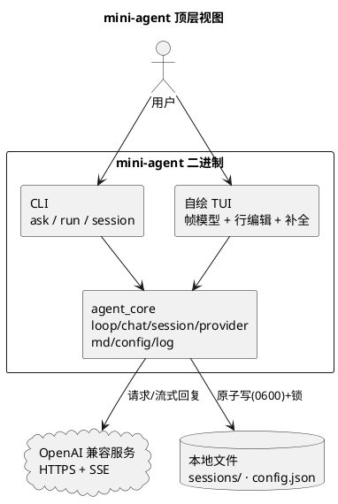

# AI 原生项目模板

一套技术栈中立的项目起点：**参考资料 → 需求与设计 → AI 开发 → 验证 → 最终设计文档**。

不绑定业务框架，不提供自动联网抓取、向量数据库或自治执行器。Python 3.11+ 用于模板工具（支持 Linux 与 macOS），无第三方 Python 依赖。支持可选 C++、Python、TypeScript、Go 和 Rust 起步配置，未选择时仍保持技术栈中立。

## mini-agent 项目

本仓库已初始化为 C++ 项目 **mini-agent**：Linux 终端下快速启动的轻量 AI Agent，提供 CLI 单次调用与自绘 TUI 多轮对话，一进程一会话（多开 = 多进程）。v1 已实现并通过验证（内核 / Provider / session / CLI / TUI / 日志 / Markdown）；v2 工具层已落地（工具调用循环、内置 run_bash 命令执行、MCP stdio/Streamable HTTP 客户端，设计 008，使用见 [MCP 与工具使用指南](docs/mcp-usage.md)）。



- 快速开始：`python3 scripts/init_project.py`（本仓库已完成）→ `python3 scripts/check.py --strict-project`；构建 `cmake --preset linux-gcc-debug && cmake --build --preset linux-gcc-debug`；安装 `cmake --install build/linux-gcc-debug`（默认前缀 `~/.local`，二进制落到 `~/.local/bin/mini-agent`）。
- 架构见 [docs/architecture.md](docs/architecture.md)；设计见 [docs/design/007-agent-v1.md](docs/design/007-agent-v1.md)；决策见 [docs/decisions/README.md](docs/decisions/README.md)。
- 文档中所有示意图统一使用 PlantUML（仓库离线不渲染，可贴在线服务器或本地 `plantuml` 查看）。

以下为通用模板说明，适用于本仓库的工具层（`scripts/`、`profiles/`、`workflows/`）。

## 第一次使用？先读完整手册

阅读 **[从模板到项目交付：使用者完整手册](docs/user-guide.md)**，按照 12 个步骤完成自己的项目。手册包含可直接交给 AI 的提示词、第三方参考配置、任务拆分、业务质量门禁、最终设计、CI 与发布清单，并用一个本地 CSV 工具说明完整过程。

如果只需要最短初始化步骤，继续阅读下面的快速开始。

## 按语言创建项目

本模板面向 **Linux 和 macOS**，不提供 Windows 支持。

主要面向 Linux + GCC/Clang 的 C++ 项目可直接使用：

```sh
python3 scripts/init_project.py --name my-cpp-project --description "项目目标" --language cpp --dry-run
python3 scripts/init_project.py --name my-cpp-project --description "项目目标" --language cpp
python3 scripts/check.py --strict-project
CPP_PRESET=linux-clang-debug python3 scripts/check.py --strict-project
```

第三步在 Linux 上默认使用 linux-gcc-debug，在 macOS 上回退到通用 `dev` preset（Ninja + 当前默认编译器，实测为 AppleClang）。最后一步的 `linux-clang-debug` 有 Linux host condition，**只能在 Linux 上运行**；两个 Linux preset 家族共覆盖 GCC/Clang × Debug/Release 四种组合，项目 CI 跑完这四组合。macOS 上验证 Clang 请使用 `--preset dev` 或 `release`，不要把 AppleClang 结果当成 GCC 证据。初始化不安装任何依赖。

- [C++](docs/languages/cpp.md)：Linux GCC/Clang 优先，C++17、CMake/CTest、四组合 CI、告警、可选 clang-format/clang-tidy/sanitizers。
- [Python](docs/languages/python.md)：`--language python`，标准库应用、unittest、pyproject。
- [TypeScript](docs/languages/typescript.md)：`--language typescript`，strict 类型检查、构建和 Node 测试，依赖及锁文件需另行审查安装。
- [Go](docs/languages/go.md)：`--language go`，modules、gofmt、vet、测试和构建，可选 race。
- [Rust](docs/languages/rust.md)：`--language rust`，edition 2024、Cargo、rustfmt、Clippy、单元/集成/文档测试。
- [选择与迁移说明](docs/languages/README.md)：`generic` 不生成业务骨架，已有项目不自动迁移，不覆盖已有文件。

这些配置提供最小示例和检查入口，不是已完成的业务项目。下面是保持 generic 的通用路径。

## 快速开始

1. 将本目录发布为独立仓库，在 GitHub 设置为 Template repository 后通过 Use this template 创建新项目；GitLab 请按所在实例支持的模板机制配置。也可直接复制本目录。模板本身不会初始化 Git 或操作远端。
2. 在 AI 工具中将**本目录作为工作区根目录**打开，而不是其父目录。
3. 在终端执行：

```sh
python scripts/doctor.py
python scripts/init_project.py --name my-project --description "项目的一句话目标" --stack "待选择"
python scripts/check.py --require-initialized
```

   可先加 `--dry-run` 查看初始化计划。generic 仅修改 `project.json` 和项目背景中的声明占位符；指定语言还会按 manifest 新建该语言骨架和项目 CI。同名文件或已有质量命令冲突时拒绝覆盖。不安装依赖、不拉取外部仓库、不操作 Git、不覆盖已初始化项目。
4. 补充 [项目背景](docs/project-context.md)、[架构](docs/architecture.md)，按照 [参考资料索引](docs/references/README.md) 指定第三方来源。
5. 选择业务技术栈后，将格式/Lint/测试/构建命令填入 `project.json` 的 `quality_commands`，并配置 CI 所需运行时与依赖安装。语言配置已接入最小起步命令，但仍需按业务补充。详见 [开发指南](docs/development.md)。
6. 执行 `python scripts/check.py --strict-project`，确保项目 CI 使用相同命令。通用 `ci.yml` 显式只测模板工具；语言初始化新增的 `project.yml` 才负责语言项目门禁。generic 项目需自行创建业务 CI。
7. 按 [AI 启动验收](docs/ai-onboarding.md) 检查规则是否被实际发现，再开始第一个任务。

## 给 AI 的第一个任务

```text
请先读取 AGENTS.md，并执行 docs/ai-onboarding.md 中的启动验收。
说明你实际读取的文件、项目目标、验证命令、相关参考及缺失信息。
只做检查和说明，不安装依赖、不联网抓取、不修改文件。
```

规则不自动生效时，显式要求读取 `AGENTS.md`。打开仓库不意味着 AI 会读取所有文件、访问所有 URL 或执行脚本。

## 目录导航

| 入口 | 用途 |
| --- | --- |
| [完整使用手册](docs/user-guide.md) | 从创建项目到验证、设计交付和发布的逐步操作 |
| [AGENTS.md](AGENTS.md) | AI 统一工作规则 |
| [开发指南](docs/development.md) | 环境、命令和技术栈接入 |
| [MCP 与工具使用指南](docs/mcp-usage.md) | v2 工具层使用者文档：MCP server 配置、审批交互、`--mcp`/`mcp list`、安全边界 |
| [语言配置](docs/languages/README.md) | C++ 优先的语言规范、工具链与起步代码 |
| [参考资料](docs/references/README.md) | 资料选择、版本与使用边界 |
| [设计索引](docs/design/README.md) | 草案至最终设计的生命周期 |
| [决策索引](docs/decisions/README.md) | 重要设计取舍 |
| [任务模板](templates/task.md) | 范围、参考、验收标准 |
| [设计模板](templates/design.md) | 最终实现与验证记录 |
| [模板维护](docs/template-maintenance.md) | 升级、发布与安全注意事项 |

`workflows/` 是按需阅读的流程文档，不是自动执行引擎。`profiles/` 保存未启用的骨架源文件；初始化只生成所选语言。`tests/` 的 Python 文件覆盖模板工具，选定语言后另有示例测试，业务测试仍需按需求补充。

## 已提供的工具适配

- `AGENTS.md`：供支持该约定的工具使用，发现范围以工具文档和实测为准。
- `CLAUDE.md`：引导读取统一规则。
- `.github/copilot-instructions.md`：仓库级薄适配，需要相应客户端启用指令支持。

以上是入口文件，不是已验证的多工具兼容性保证。不支持这些入口的工具可通过会话提示显式加载。每个新工具须完成启动验收，不能仅凭文件存在判断生效。当前已在 pi 0.84.4 上实测通过（含禁用上下文文件的对照组），其他客户端仍需各自验收：[记录](docs/design/005-macos-verification.md#已执行结果)。

## 质量与安全边界

基础检查包括：配置结构、模板占位符、Markdown 本地相对链接、文档控制字符/行尾空格和模板工具单元测试。它**不包含**完整 Markdown linter、业务类型检查、业务测试、密钥扫描、依赖漏洞扫描或外部链接可用性验证。按技术栈和公司政策添加这些门禁。

`.env` 和 `.references/` 默认忽略。忽略规则不能替代密钥管理和安全扫描。不要给来自不可信分支的 CI 配置提供生产凭据。

## 当前验证状态

当前 0.4.0 已通过 **52 个工具测试**（含 4 项锁定平台收敛的回归测试）、Go/Rust 临时项目的初始化配置检查，以及 C++ 临时项目配置和 CMake presets 解析检查。0.4 删除了全部 Windows/MSVC 配置与 CI 矩阵，变更范围、破坏性影响与迁移步骤见 [006：移除 Windows 支持](docs/design/006-drop-windows-support.md)。

2026-09-14 在一台 macOS arm64 上补做了真实工具链验证（命令与结果见 [005：macOS 补做验证记录](docs/design/005-macos-verification.md)）：C++ 在 AppleClang 21 下 Debug/Release 均完成编译并通过 CTest 与 `-Werror` 干净构建；Go 1.27.1 完成 gofmt/vet/test/build 与 `--race`；Python 与 Rust 配置结构、Rust/TypeScript 失败路径已实测；pi 0.84.4 完成 `AGENTS.md` 自动发现验收（含 `--no-context-files` 对照组）。

2026-09-14 晚在同一台 macOS arm64 上，配合 0.4 又做了一轮真实工具链验证（记录见 [006：移除 Windows 支持](docs/design/006-drop-windows-support.md)）：C++ 在 clang 23.1.1 + CMake 4.4.3 + Ninja 1.13.2 下完成 `dev`/`release` 真实编译与 CTest（1/1），并从 `compile_commands.json` 确认 `-Wall -Wextra -Wpedantic -Werror` 生效、无 MSVC 标志；**Rust 首次完成真实构建与测试**（cargo/rustc 1.98.1：Debug 与 Release 构建退出 0，单元测试/集成测试/文档测试各 1/1 通过）；Go 1.27.1 重跑 gofmt/vet/test/build 与 `--race` 全部通过；Python 起步应用 2 个测试通过；**Rust 完整四步门禁首次真实跑通**（rustfmt 1.9.0 + clippy 0.1.98：`rust_check.py` 与 `--release` 均退出 0，并经「故意破坏格式 → fmt 退出 1」「故意引入 needless_range_loop → clippy 退出 101」两组反证确认工具真实生效）；clang-tidy 23.1.1 正路径经「故意引入 `NULL` 违规被真实检出」反证确认生效（但默认 `WarningsAsErrors` 为空，故构建仍退出 0）；4 种语言 profile 初始化均退出 0 且生成的 CI 矩阵均为 `ubuntu-latest`。

以下仍**未验证**：Linux GCC/Clang 四组合编译与 CTest（本机不是 Linux、无容器、无真 GCC）、Sanitizers 正路径、Linux 下的 clang-tidy 正路径（macOS 下已实测通过）、Rust 多工具链与 MSRV 1.85 兼容性（本机无 `rustup`）、TypeScript 完整类型检查/构建/测试（未安装 `typescript@5.7.3`，不联网安装依赖）、Python 3.11/3.13 本地矩阵、远端 CI（仓库已配有远端但尚无提交）。详见 [Go/Rust 记录](docs/design/003-go-rust-profiles.md)、[Linux C++ 记录](docs/design/004-linux-cpp.md) 和 [补做验证记录](docs/design/005-macos-verification.md)。不将生成、解析或跳过当成编译通过，也不以 macOS/AppleClang 结果代替 Linux 结果。

0.2 已通过 37 个工具测试、三种语言的初始化配置检查、C++ 格式检查、Python 起步项目严格检查和 Node 脚本语法检查。

C++ 实际构建在 0.2 时期因环境缺少编译器而未完成；TypeScript 未安装编译器依赖，尚未运行完整类型检查/构建/测试。远端 CI、clang-tidy、Sanitizers 和 AI 客户端入口仍需验收。详见 [完整验证记录](docs/design/002-language-profiles.md)。这些记录描述模板交付，不代表使用者的新项目已通过业务验收。

## 发布前

本模板未替你选择开源许可证。对外发布前，由仓库所有者确认授权并添加适用的 LICENSE；第三方资料继续遵循各自许可证。
