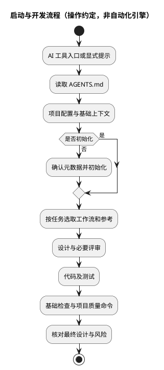

# 001：AI 项目模板核心设计

本页保留 0.1 设计与验证历史。0.2 的可选语言生成、初始化范围和 CI 分层以 [语言配置设计](002-language-profiles.md) 为准。

## 文档状态

- 状态：已实现；本地基础验证通过，跨平台 CI 和 AI 客户端验收待执行。（本文为 0.1 历史记录；当时的「跨平台 CI」指 Windows/Linux 矩阵，0.4 起 Windows 已移除、CI 仅覆盖 Linux，见本文第 7 节。）
- 适用版本：`project.json` 中的模板版本 0.1.0。
- 关联任务：建立可复用的 AI 编程仓库模板，覆盖外部参考和最终设计文档。
- 代码修订：当前本地文件，未建立 Git 提交或 PR。
- 人工评审：无评审通过记录。

## 1. 背景与目标

新项目应能复用同一套 AI 工作规则，通过明确的上下文、参考资料、任务流程和质量入口，减少重复配置，并形成与实现一致的最终设计文档。

## 2. 范围与非目标

已提供规则入口、文档模板、参考管理、开发工作流、初始化和检查工具、工具测试及 GitHub CI 配置。

不提供业务框架、自动联网抓取、向量数据库、自治代理、平台远端配置或自动模板升级。Python 仅承担模板工具实现，不约束业务技术栈。

## 3. 约束与参考资料

- 支持无 Bash 的开发环境，工具只依赖 Python 3.11+ 标准库。
- Python API 参考登记于 [python-tooling](../references/python-tooling.md)，本次未在线核对来源，也未复制第三方实现。
- AI 工具是否自动发现规则取决于客户端；薄适配不能被描述为强制加载机制。
- 默认不安装依赖、不下载参考仓库、不操作 Git、不读取凭据。

## 4. 方案与关键取舍

- 以 `AGENTS.md` 为规则事实来源，其他入口只引导读取，避免规则多份维护。
- 启动时读取少量基础上下文，相关工作流和外部资料按任务选择，避免全量加载。
- 参考资料先用 Markdown 索引，不引入需要维护的抓取或检索服务。
- `project.json` 保存初始化状态、模板版本和质量命令；业务事实与详细设计留在文档中。
- 基础检查与业务门禁分开，模板可在未初始化时验证工具，但不能被误称为业务可交付。
- 使用标准库单元测试验证工具，不绑定业务测试框架。

## 5. 详细设计

### 启动与开发流程

该图描述操作约定，不表示模板含有执行所有步骤的自动化引擎。

### 初始化

`scripts/init_project.py` 校验名称、描述和技术栈，只替换 `docs/project-context.md` 中三个声明占位符，并更新 `project.json`。支持交互参数和 `--dry-run`，拒绝重复初始化和占位符缺失/重复；保留其余内容。文本元数据做 Markdown 转义。

不执行任意全仓库替换，不安装依赖，不修改远端。普通写入错误时尝试恢复两个文件；不保证断电、并发写入或恢复失败时的事务性。

### 检查

`scripts/common.py` 负责配置、必需文件、基础 Markdown 和占位符校验。

`scripts/doctor.py` 只诊断环境和配置。

`scripts/check.py` 先检查基础条件，再运行模板工具测试和 `quality_commands`。质量命令用参数数组、仓库根目录和超时执行，不主动启用 shell；非零退出、无法启动和超时均记为失败。

- 默认模式允许未初始化的发布模板。
- `--require-initialized` 要求已初始化。
- `--strict-project` 另要求至少存在一项业务质量命令；不能判断命令覆盖是否充分。

### 文档生命周期

同一份功能设计从草案演进至最终实现说明。系统级内容在架构总览，重要取舍进入 ADR，来源版本和阅读范围进入参考目录；用链接关联而不是重复粘贴。

## 6. 异常与安全设计

- 不可信外部资料不能改变项目授权，也不能触发凭据上传或脚本执行。
- 第三方代码复用需先核实许可。
- `.references/` 和真实环境文件默认忽略，但不构成权限沙箱或密钥扫描。
- 工具检查的仓库代码及质量命令仍有执行权限，必须在可信或隔离环境运行。
- CI 默认只读权限、不保留 checkout 凭据；分支保护及人工审批仍需平台设置。
- 无法访问参考、未执行检查或未完成人工评审时必须明确说明。

## 7. 兼容性与发布

0.1 交付时提供 Windows/Linux、Python 3.11/3.13 的 CI 矩阵，本地实际运行环境是 Windows、Python 3.14.4，macOS 当时未实测。

当前状态：CI 矩阵仅保留 Ubuntu × Python 3.11/3.13，Windows 支持已在 0.4 整体移除，见 [006：移除 Windows 支持](006-drop-windows-support.md)；macOS 已实测，见 [005：macOS 补做验证](005-macos-verification.md)。

从模板创建项目后不自动同步更新，按模板版本显式迁移。对外发布前确认许可证及公司政策。回滚依靠用户备份或版本控制，模板不自动创建提交。

## 8. 验证情况

| 验收项 | 证据或测试位置 | 实际命令 | 结果 | 限制 |
| --- | --- | --- | --- | --- |
| 环境和文件配置 | doctor 输出 | `py -3 scripts/doctor.py` | 通过 | Python 3.14.4，Windows |
| 配置、文档及模板工具 | `tests/test_template.py` | `py -3 scripts/check.py` | 基础检查通过，20 个测试通过 | 不代表业务质量验证 |
| 初始化安全及 dry-run | 初始化、重复执行、非法输入、占位符、写入恢复测试 | 同上 | 通过 | 使用临时目录，不包含断电或并发测试 |
| 链接和占位符检查 | 文档与参考目录排除测试 | 同上 | 通过 | 非完整 Markdown 解析器 |
| 命令错误处理 | 子进程失败及超时测试 | 同上 | 通过 | 错误路径使用 mock，不验证进程树清理 |
| 跨平台 CI | `.github/workflows/ci.yml` | 未执行 | 待验证 | 尚未发布远端 |
| 实际 AI 入口发现 | `docs/ai-onboarding.md` | 未执行 | 待验证 | 需针对具体客户端操作 |

## 9. 实现偏差与已知限制

- 未预置业务技术栈或业务示例，避免替用户做未经确认的框架选择。
- 自动检查只覆盖基础配置、文档和工具测试，未配置完整 Markdown linter、密钥扫描、依赖扫描或业务门禁。
- Markdown 检查不覆盖锚点、引用式链接、HTML 链接或外部可用性。
- 初始化成功不等于需求完整；用户仍需补充目标、约束、参考资料和验收标准。
- `python` 在本机是 Windows 商店占位程序；实际验证通过 `py -3` 完成。
- 尚无远端仓库、跨平台 CI 运行或真实 AI 客户端验收证据。
