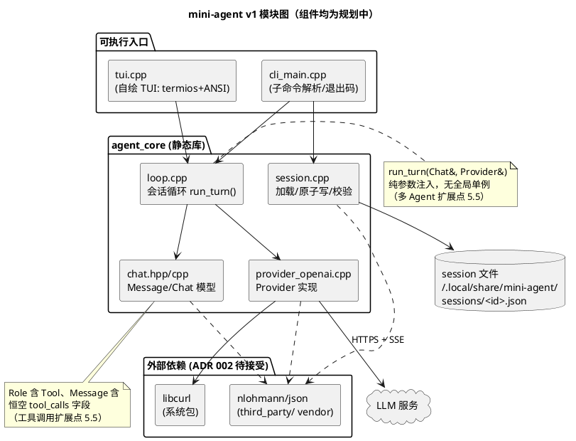
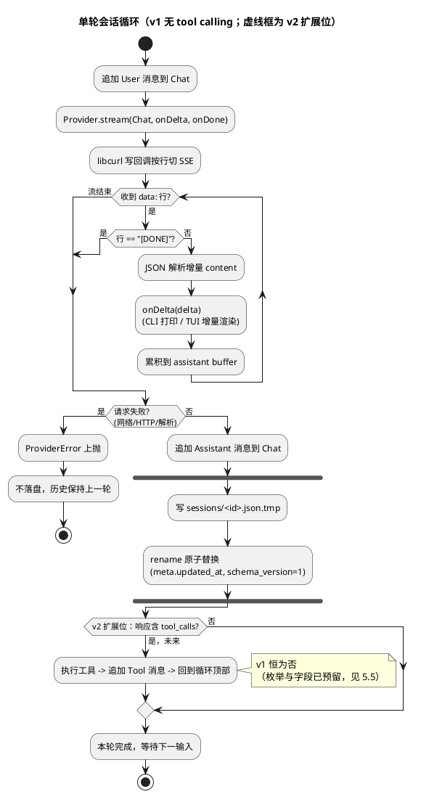
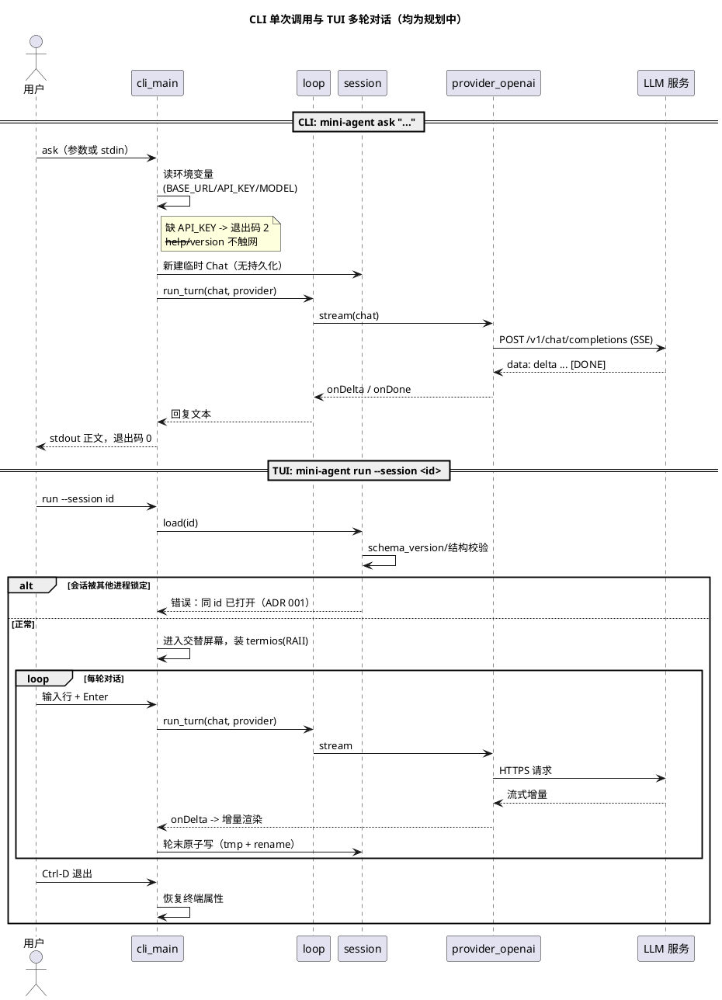
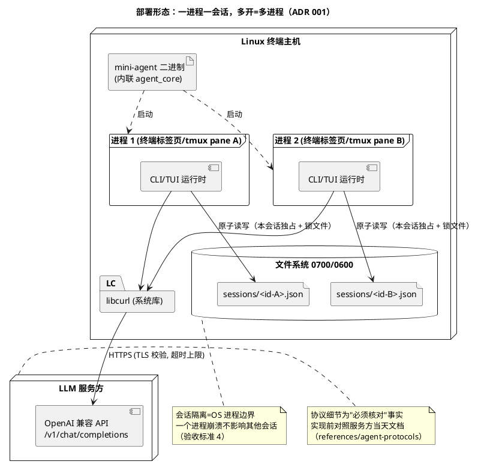

# mini-agent 第一版技术方案（内核 + CLI + TUI + 多 session）

## 文档状态
- 状态：已实现（2026-11-01：内核/Provider/session/CLI/自绘 TUI 全部交付并验证；待人工评审）。
- 关联任务：项目背景见 [project-context.md](../project-context.md) 用户与场景、范围与非目标。
- 核对日期、适用版本或代码修订：2026-10-31；基于 cpp profile 骨架（starter_core/starter_cli，CMake >=3.23，C++17）。参考资料仅登记于 [references/](../references/)，其中 coding-agents 条目**尚未在线核对**，本文引用其设计意图而非具体实现事实。
- 人工评审记录：无。维护者 2026-11-01 指示开始第一步开发，三条 ADR 据此接受；整体设计仍待人工评审。

## 1. 背景与目标

开发者需要一个 Linux 终端下快速启动的轻量 AI Agent：CLI 单次调用、TUI 多轮对话、可多开互不干扰的 session。成功标准沿用项目背景草案（冷启动 <=100 ms 不含网络、CLI 可脚本组合、TUI 完整对话轮、>=2 会话隔离且崩溃互不影响、`--strict-project` 覆盖 configure->build->CTest）。

## 2. 范围与非目标

本期交付：

- `agent_core` 静态库：会话循环（消息历史 -> LLM 请求 -> 流式响应 -> 追加历史）、session 持久化、Provider 客户端抽象。
- `mini-agent` CLI 可执行文件：`ask` 子命令单次提问（支持 stdin 管道）、`run` 进入 TUI、`session` 子命令列表/恢复/删除。
- 最小 TUI：自绘终端界面（交替屏幕 + 原始模式），多轮对话、流式显示、Ctrl-C/Ctrl-D 干净退出。
- 多 session：一进程一会话，会话文件独立，天然隔离。

非目标（同项目背景）：Windows/macOS、IDE 插件、本地推理、工具调用（function calling）、上下文压缩、跨会话操作、多 Agent、模型评测。

扩展性立场：上述能力 v1 **不实现**，但接口与数据格式按第 5.5 节预留低成本扩展点，避免未来为支持它们破坏 session 文件格式或 Provider 接口。预留以"形状正确、不写未用代码"为限（YAGNI 约束：只接受几乎零运行时代价的结构决策，不做投机性抽象层）。

## 3. 约束与参考资料

- 项目约束（必须遵循）：Linux + CMake；不无故新增依赖，新增前核实许可证并记 ADR；密钥走环境变量不入仓库；快速启动为首要体验目标。
- 设计参考（未在线核对，仅登记意图）：
  - [coding-agents.md](../references/coding-agents.md)：mini-swe-agent 的最小循环（system + messages + 终止条件）、Aider 的错误恢复思路——映射为 v1 的"单层循环 + 请求失败即报错退出，不自动重试"。
  - [agent-protocols.md](../references/agent-protocols.md)：OpenAI Chat Completions 事实（`/v1/chat/completions`、SSE `data:` 行、`[DONE]` 哨兵）按 [references/README.md](../references/README.md) 规则属于"必须核对"项，实现前需对照选定服务方当天文档，本文接口仅标注为待核对假设。
  - [agent-frameworks.md](../references/agent-frameworks.md)：LangGraph 检查点语义 -> 本文的"每轮结束原子写 session 文件"，取"崩溃后不丢已完成轮次"这一点，不引入状态机框架。
- 本地差异：参考项目多为 Python/TypeScript 运行时框架；本项目是低依赖倾向的原生 C++ 二进制，冷启动与内存占用特性完全不同，不可照搬其循环内建重试、向量检索等模块。

## 4. 方案与关键取舍

三项重大取舍各对应一条提议 ADR，选定方案如下，待人工确认后转"已接受"：

| 取舍 | 选定方案 | 主要备选 | ADR |
| --- | --- | --- | --- |
| 会话形态 | 一进程一会话，多开=多进程；session 落盘 `~/.local/share/mini-agent/sessions/<id>.json` | 单进程多会话管理器 | [001](../decisions/001-session-model.md) |
| LLM 传输与 JSON | 链接系统 libcurl；JSON 用单头文件 nlohmann/json（构建期放入 `third_party/`，附许可证核实记录） | 纯 POSIX socket + TLS 自实现（工作量/风险不成比例）；手写迷你解析器（脆弱） | [002](../decisions/002-http-json-dependency.md) |
| TUI 实现 | 自绘最小 TUI（POSIX termios + ANSI 转义，约数百行，零依赖） | FTXUI 等第三方库（许可义务、增加体积与启动路径） | [003](../decisions/003-tui-approach.md) |

Provider 协议假设：兼容 OpenAI Chat Completions 的 HTTP 服务。配置来源（2026-11-01 更新，维护者要求免环境变量启动）：环境变量（`MINI_AGENT_BASE_URL`/`MINI_AGENT_API_KEY`/`MINI_AGENT_MODEL`）**优先覆盖**配置文件；文件为 `~/.config/mini-agent/config.json`（`MINI_AGENT_CONFIG` 可指定路径，遵循 XDG），TUI 内 `/provider <url>`、`/login <key>`（无参数时掩码行输入）、`/model <name>` 写入，`/config` 查看（密钥只显示"已设置"）。`ask`/非 TTY `run` 在合并配置不完整时退出码 2 并提示两种配置方式；TTY `run` 允许未配置进入，提交时提示命令。每轮从配置快照构造 Provider（无全局单例，5.5 多 Agent 预留）。

## 5. 详细设计

模块与目标（现有 starter_* 目标将重命名；除已存在的 starter 骨架外，下列均为**规划中，未实现**）：

```text
include/mini_agent/            src/                      目标
  chat.hpp        消息/历史模型   src/chat.cpp             agent_core (STATIC)
  provider.hpp    Provider 接口    src/provider_openai.cpp  agent_core
  session.hpp     持久化          src/session.cpp          agent_core
  log.hpp         spdlog 包装      src/log.cpp                agent_core
  md.hpp          宽度/wrap/clip + src/md.cpp                  agent_core
                  Markdown 渲染（md4c 解析，ADR 004）
third_party/md4c/  vendored md4c.h/md4c.c（C，MIT 记录同目录）
  loop.hpp        会话循环        src/loop.cpp             agent_core
  tui.hpp         自绘 TUI        src/tui.cpp              agent_core
                                            src/cli_main.cpp      mini-agent (exe)
tests/cpp/                      单元与契约测试             agent_test
third_party/nlohmann/           单头 JSON（待 ADR 002 接受）
```

依赖方向：`mini-agent -> agent_core -> {curl, nlohmann}`。CLI 与 TUI 共用同一循环入口 `loop::run_turn(Chat&, Provider&)`，core 不含终端渲染细节以外的 TUI 逻辑。

### 5.1 图形视图（PlantUML）

以下图中的 `agent_core`、`mini-agent` 等业务组件均为**规划中，未实现**（当前代码仅 starter 骨架）。语法为 PlantUML，仓库离线不渲染；评审时可贴到 PlantUML 在线服务器或本地 `plantuml` 查看。

**模块图（组件与依赖方向）**：



**会话循环流程图（单轮 `run_turn` 控制流）**：



**CLI / TUI 时序图（session 生命周期）**：



**部署图（运行形态与多 session 隔离）**：



构建部署链（文本）：`CMake presets（linux-gcc/clang × debug/release）→ build/<preset>/ → 单二进制 + 运行期依赖系统 libcurl`；无容器、无守护进程、无安装步骤要求（v1 直接运行构建产物即可，发布与回滚见第 7 节）。

核心数据结构（规划）：

- `Message { Role role; std::string content; }`；`Chat { std::vector<Message> messages; }`。
- `SessionMeta { schema_version; id; created_at; updated_at; model; }`；session 文件为 JSON：`{meta, messages}`。
- `Provider` 接口：`void stream(const Chat&, OnDelta cb, OnDone cb)`，`OnDelta(std::string_view)` 供 CLI 打印与 TUI 增量渲染；错误经 `ProviderError` 分类（网络、HTTP 状态、协议解析）。

会话循环（v1，无 tool calling）：追加用户消息 -> `provider.stream` 累积助手回复 -> 每轮成功后原子写 session 文件（写临时文件 + `rename`）。一轮内失败不落盘，历史保持上一轮状态。

### 5.5 扩展点设计（为 v2+ 预留，v1 不实现功能）

**工具调用（function calling）**

- `Role` 枚举定义完整集合：`System / User / Assistant / Tool`，v1 仅前三种产生数据，`Tool` 消息的序列化/反序列化路径在 v1 的 chat 单测中即覆盖（读旧文件遇 `tool` role 必须能解析）。
- `Message` 预留可选字段 `tool_calls` / `tool_call_id`（v1 恒空；JSON 写出时省略空字段以保持文件紧凑）。
- 循环形态即扩展位：v1 的单次 `run_turn` 未来升级为"模型返回 tool_calls -> 执行 -> 追加 Tool 消息 -> 再请求"的内层循环；`Provider::stream` 签名不变，请求体增加 `tools` 数组属 Provider 实现内部（OpenAI 兼容协议本身允许）。
- 工具注册表不进 v1 头文件；届时以独立 `tools.hpp` + 回调表引入，避免空抽象。

**上下文管理（压缩/修剪）**

- 上下文构造与 Provider 调用解耦：`run_turn` 接收 `const Chat&`，Provider 只消费"本轮发送的消息视图"。未来压缩器位于 Chat 与 Provider 之间（选择发送哪些消息），不改 session 文件的完整历史——文件是事实记录，发送窗口是派生视图。
- session JSON 的 `messages` 保持追加式数组；v1 即按"`content` 为字符串、角色显式"存储，为后续摘要消息（`system` 注入或 `role: summary` 方案，届时另记 ADR）留出兼容读取：解析器对未知 role 值报错而非丢弃。

**跨 session**

- schema 兼容：`meta.schema_version = 1`；加载时对更高版本拒绝并提示升级，对新增可选字段忽略（forward-read 规则写入 session 单测）。
- 目录结构即接口：`sessions/<id>.json` 一文件一会话，跨会话检索/克隆/导出（如 `session fork <id>`）只是对目录与 id 的批量操作，进程模型（ADR 001）不需推翻——一进程一会话约束的是运行态，不限制未来的管理型子命令。
- id 为随机十六进制（不含语义），避免将 agent 或父子关系编码进 id；届时关系存于 `meta`（可选字段 `parent_id`，v1 不写）。

**多 Agent**

- 关键预留只有一条：`Provider`、`Chat`、`Session` 均不假设全局单例——`run_turn(Chat&, Provider&)` 是纯函数式入口，配置（base_url/model）经参数注入而非静态全局。一个 agent = 一组（Provider 配置 + Chat + session 文件），多开形态（ADR 001 的进程隔离）天然就是一种多 agent 部署。
- Agent 间通信、编排图、共享内存历史均**不预留**（属新模块新设计，参考 [agent-frameworks.md](../references/agent-frameworks.md)，届时另出设计与 ADR）；强行预留消息总线只会制造死代码。

成本核算：以上预留 = 枚举多一个值、两个恒空可选字段、`schema_version` 整数、"参数注入而非全局单例"的纪律。无新增依赖、无运行时代价，`--help` 冷启动预算不受影响。

### 5.6 TUI 帧模型（自绘实现约束，规划中；设计输入见 [references/coding-agents.md](../references/coding-agents.md) 2026-11-01 核对结论）

自绘 TUI（ADR 003）实现时必须遵循以下从开源 Agent 提炼的结构，避免在回调里同步刷屏的朴素写法：

1. **事件与渲染分离**（借鉴 Codex CLI，Apache-2.0，只取模式）：`Provider::complete` 的 `on_delta` 回调只做"追加到输出缓冲 + 置 dirty 标记"（互斥保护），渲染由主循环 `poll(stdin/信号, ≤50 ms tick)` 抽干缓冲后按帧重绘。SSE 高频 delta 不得直接触发终端写调用。
2. **最小重绘范围**（借鉴 Aider）：已完成历史滚动进 scrollback 一次打印；原地刷新区为"钉定的当前问题行 + 响应尾部窗口 + 补全提示行（条件显示）+ 输入行 + 状态行"。不做全屏 diff。**问题钉顶**（2026-11-01 维护者要求"输出内容时保持输入的内容一直固定显示"）：streaming 期间块首行实时重显已提交问题（`你: …`）——它要到回合结束才回显进历史区，此前若不钉住就会在刷新区消失；行级 diff 的前缀跳过使其只在流式首帧实际写入一次、后续帧原样驻留（零重画）。**尾部窗口随终端高度增长**（2026-11-01 维护者要求"输出应刷新整个终端而不是只在底部动"）：行预算自 `终端行数 − 1 行余量 − 状态行` 递减分配，裁剪优先级低→高为 尾部窗口 → 提示行 → 钉定问题 → 输入行，替代旧的固定 6 行；整个 live 块始终 ≤ rows−1 行且每帧结束时光标停在块底下一行，因此块顶不会越过屏幕首行触发终端 auto-scroll——`\x1b[nA` 回退计数依旧精确，硬换行不变量（见下）不被破坏；块收缩时显式清除残留行。每帧输出包裹 CSI 2026 同步输出（`?2026h/l`，借鉴 Pi TUI，只取模式、MIT），终端原子提交整帧、消除逐行闪烁。**帧内行级 diff 与输入缓存**（2026-11-01 补齐，借鉴 Pi `TuiMainScreen` 差分渲染 + `requestRender` 脏标记，只取模式）：`render()` 入口按 (tail, pinned question, composer, status, streaming, rows, cols) 缓存输入，完全相同则零工作量返回（空转 poll tick 不再触发 wrap/分配/比较）；通过输入检查后逐行与前帧比较，跳过未变化的前缀行、只重写变化区间（行由 `md::wrap` 以 reset 结尾，跳过不会样式泄漏）；`commit()`/`clear_live()` 移动活区后强制缓存失效。diff 仅作用于前缀跳过，块收缩清理保持原路径逐字节不变，避免重新引入重复行类缺陷。**行记账采用硬换行模型**（2026-11-01 修复"每次提问输出大量重复行"）：所有写入终端的行由我们自己按显示宽度（含 CJK 双宽，wcwidth 子集表）硬换行到 <=cols，每行恰好占一个终端行，`\x1b[nA` 上移计数因此永远精确——不再依赖终端 auto-wrap。旧实现按码点数折算行数，中文（双宽）与含换行的多行回复都会使 live_rows_ 少算，光标回卷错位，每帧残留一行旧内容形成重复行堆积。配套：未变化帧跳过重绘、状态行超宽裁剪、pty 冒烟含虚拟屏重放断言（0 重复行 + 行宽不变量 + 窗口随高度增长 + 问题钉顶）。

   **新活区不得回退历史行（2026-11-02 修复）**：`live_rows_ == 0`（首次绘制或 `commit/clear_live` 后）必须跳过 cursor-up，不能输出 `CSI 0 A`——终端把零距离解释为默认上移 **1 行**，会使下一次空闲帧覆盖刚提交的回复末行，单行回复因此完全消失。PTY 回归不仅检查输出字节中出现过回复，还以虚拟屏重放 cursor-up/down、擦行、换行和滚屏，验证发送 `hello` 后回复保持可见、连续三轮回复均未被后续帧覆盖。

   已知局限（明示，非缺陷掩盖）：a) 流式窗口是**滑动**而非真滚动——超出窗口的更早行不进入本次 scrollback 增量，中途向上滚看不到回复头部（Pi 式全文档 diff 可消除，但要求回合结束整屏重打、且推翻"定格才套样式"契约，超出 v1 小步原则，留待 v2 评估）；b) 窗口行数在**帧提交时**结算：若一次帧内增长超过 rows−1 行（极端高频 mock/慢渲染），尾部窗口保留最后 rows−1 行、更早内容推迟到定格打印，中间态存在可感知的"内容跳跃"；c) 终端高度变化（resize）后下一帧按新高度重排，旧帧行残留由收缩清除路径兜底，未做 SIGWINCH 即时重绘。
3. **键位契约**（Codex/Crush/Hermes 高度一致，免费继承肌肉记忆）：Enter 提交；Ctrl-C 或单独 **Esc** 中断当前请求（历史保留、错误行进历史区；Esc 无"再按退出"升级语义，2026-11-02 维护者要求，对应规则 5 状态行早已声明的 esc-to-interrupt）、Ctrl-C 第二次或 Ctrl-D 退出；Ctrl-L 强制清屏重绘。斜杠命令支持 **Tab 前缀补全**（输入行以 `/` 开头时）。**方向键编辑（2026-11-01 维护者要求）**：←/→ 按 UTF-8 码点移动光标（光标=字节偏移、恒处码点边界），插入/退格在光标处进行，Home/End（`\x1b[H/F`、`\x1b[1~/4~`）跳线首/线尾，Delete（`\x1b[3~`）删光标下码点；↑/↓ 单行历史召回（bash 草稿驻留语义：编辑召回行后 ↓ 可返回原草稿；斜杠行不入历史，Tab 菜单负责召回），启动时从恢复会话的 user 消息播种。光标以反显方块渲染（`\x1b[7m`/`\x1b[27m`，SGR 零宽，硬换行记账不受影响），不启用终端物理光标。ESC 序列整段解析消费（修复此前方向键把 `[C` 等字节漏进输入文本的缺陷），单独 ESC（后随非 `[`/`O`）在 streaming 中触发中断、空闲时丢弃；masked `/login` 不显示光标、方向键吞弃不编辑；其余未绑定转义序列一律安全丢弃。v1 无多行编辑：光标移动限单行（跨折行移动需虚拟行映射，列 v2）。补全可发现性提示（2026-11-01 维护者要求；同日改为垂直列表）：composer 为 `/` 行时，在其**下方**实时显示补全菜单——表头行 `Tab completion (cycle with Tab):`，随后每个前缀匹配独占一行（两空格缩进）；无匹配时单行"Tab completion: no matching command (see /help)"。由纯函数 `slash_completion_hint` 从**原始** composer 派生（返回行向量；渲染串携带光标/掩码装饰，不得参与匹配）；行预算不足时从列表**顶部对齐截断**（保留表头，与保留尾部的响应窗口方向相反——菜单头部信息价值更高）；masked `/login` 输入不触发。
4. **错误进展示层不进存储**（对应第 5 节失败轮回滚）：`ProviderError` 文本以 `[error] network: …` 行渲染进历史区，Chat 与 session 文件保持上一轮状态。
5. **状态行内容**（借鉴 Crush 状态行；Crush 为 FSL-1.1-MIT，**禁止复制其代码**）：`model=… · session=<id> · <idle|streaming esc-to-interrupt>`。
6. **启动 splash 一次性打印**：版本/model/session id 进历史区首行，之后不再重绘该区域。
7. **模型发现与选择（2026-11-02 维护者要求）**：`/provider <url>` 与 `/login <key>`（带参或掩码输入两条路径）保存成功后，若 base_url 与 api_key 齐备则自动发起 `GET {base_url}/models`；`/models` 作为显式命令手动重列（跳过指纹缓存）。**网络不得阻塞帧循环**：复用规则 1 的事件/渲染分离——独立 `models_worker` 线程只写结果 + 置 `atomic<bool>`，菜单绘制与日志均在主线程 join 后执行（`logger` 会被 `/log` 重新赋值，绝不可在 worker 内使用）。列举超时收紧到连接 5 s / 总 15 s，不得沿用聊天 120 s 预算。**结果处理**：`parse_models_json` 为纯函数且失败关闭（非对象根、缺 `data` 数组、`data` 非数组均报错），返回 id 排序去重；列表以编号菜单 `commit` 进历史区，表头 `models (N): …`、每行 `N. id`（当前项标 `<- current`）、页脚说明按键。Enter 输入序号或完全匹配的 id 即选定（写入 config + session.meta 并原子保存），其它输入关闭菜单后**原样 fall through**，保证 `/model <name>` 与普通提问仍可用；单独 Esc 关闭菜单。**不新增历史**：菜单选择与斜杠命令同样不入 chat history。状态行瞬时追加 `· listing models...` / `· pick a model (Esc cancels)`，二者与 `queued N` 共享单行裁剪预算（`md::clip`）。**密钥边界**：api_key 仅出现在 Authorization 头，不入菜单、不入 ProviderError 文本、不入日志。
8. **分批配置录入（2026-11-02 维护者要求）**：`/provider`、`/login`、`/model` 本就**各自独立保存**（任一条都可单独完成，也可分属不同进程/不同时段），本条补齐的是**反馈**：不得在已完成部分配置时仍打印全部三条命令（那会被读成“必须一次性输入”）。纯函数 `config_next_hint(config)` 返回 `config N/3 · next: <唯一下一步>`（按 provider → key → model 顺序取第一个缺项，齐备时 `config 3/3 · ready`），只报**字段是否就位**、永不回显字段值，因此 api_key 不可能经提示行泄露。接入点：启动 warn、提交时 `[error] LLM not configured`、排队消息被丢弃时、`/models` 前置条件不满时、以及 `/provider` `/login` `/model` 保存成功后的进度行（`save_and_report(show_progress)`，`/log` 不触发以免噪声）。`/help` 显式声明三者互相独立。`/model` 无参时若 url+key 就绪额外提示 `/models`。

9. **登录（凭据）状态显示（2026-11-02 维护者要求）**：`/provider` 与 `/login` 之后必须告知“这组凭据能不能用”。**不新增任何网络请求**：规则 7 在那一刻已经发过一次 `GET /models`，它天然就是认证探针（拒密钥的服务回 401/403，任何 2xx 即证明凭据被接受，即使随后 body 解析失败）。为此 `ProviderError` 增加 `http_status()`（仅 HttpStatus/Protocol 携带，其余为 0）以区分“密钥被拒”与“根本没连上”。纯函数 `AuthProbe` + `auth_status_line` + `auth_log_token` 分类为 `untried | verified | rejected | unreachable | refused`（401/403 → rejected；其他非零状态 → refused；无响应 → unreachable；2xx → verified），输出单行英文提示且**绝不回显密钥**；不得再拼一次字符串判断（否则不可单测）。展示位置：探测完成后的历史区、`/config` 的 `login=` 行、启动时若配置已齐备则提示 `unverified`（启动**不**主动探测，以免击穿冷启动预算）。凭据变更（`/provider` 或 `/login` 任一修改）必须将 `auth` 重置为 `AuthProbe{}`，不得沿用旧结论。日志记 `login status=<token> models=N [http_status=N]`，状态码仅在确实收到响应时才输出（否则 `http_status=0` 会被误读为异常响应）。状态行（live 区）**不加**登录标记：该行已被 `md::clip` 单行裁剪，再加内容会挤掉 `queued N`（已有回归教训）。

**聊天回包也是认证探针（2026-11-02 缺陷修复）**：仅由 `GET /models` 驱动结论会导致一类误报——用户能正常对话（provider 明明连通且密钥有效），提示符仍停在黄色 `?`（环境变量录入、从不跑 `/models`，或 provider 根本不开放 `/models`）。一次完成的 chat 请求也是一次凭据探测（成功的聊天是**最强证据**，没有第二条路能产生回复），故主线程在 `turn_done` 处把 `TurnResult.http_status/network_error` 折叠进同一个 `auth`（worker 仍绝不碰 `auth`/`logger`/`screen`，沿用规则 1 的线程边界）。只折叠**真凭据**：abort 回合与无状态码的本地协议错误不得翻转旧结论。**聊天引起的 verdict 变化只写日志**（`login status=… source=chat [http_status=…]`），**不向历史区 `commit` `[auth]` 行**（维护者 2026-11-02：“这种可以去掉了”——提示符已是反馈，首次回复就多一行纯噪声）；`auth_status_line` 的历史区行仍仅在显式探测（`/models` 及其自动触发）后打印，它携带状态码与模型数这类聊天给不了的信息。反向也成立：若 `/models` 回 401（部分网关不允许列模型）而聊天可用，下一轮成功会把提示符再拉回绿色——证据驱动、自纠正。

10. **提示符即连接状态标志（2026-11-02 维护者要求“用每次输入前的 `>` 标识连通状态”）**：纯函数 `connection_state(config, probe, listing)` 返回 `ConnState{Unconfigured, Checking, Verified, Rejected, Unreachable, Unverified}`，`prompt_marker(state)` 给出带样式的提示符前缀（取代原来的硬编码 `"> "`）：`?` 暗色=未配置、`?` 黄=已配置未探测、`~` 青=探测中、`>` 绿=密钥已被接受、`!` 红=密钥被拒（401/403）、`x` 品红=不可达。要点：（1）**形状与颜色同时编码**，单色终端与色弱用户不会丢信号；（2）**不新增网络请求**，只读规则 9 已有的 `AuthProbe` 结论（启动不探测，不击穿冷启动预算）；无证据时一律读作未验证，不得显示为“已连”；HTTP 503 等非认证状态归入 unverified（不能当成密钥被拒）；首次成功回包即转绿（聊天本身就是证据）；（3）**宽度不变量**：每个 marker 恰好 1 个显示列（`md::display_width == 1`），SGR 零宽且以 reset 结尾，不泄露样式，行记账（规则 2）不受影响；（4）**零额外行成本**：marker 就在输入行内，不像状态行那样占用 `md::clip` 预算，也不会挤掉 `queued N`；（5）**不入机密**：marker 不含任何文本，endpoint / 状态码 / 密钥均不可能泄露（详情仍走规则 9 的历史区行与 `/config`）；（6）文本由 (config, auth, models_running) 唯一决定，空闲 tick 输出相同 → `render()` 输入缓存仍命中（新增 `last_prompt_` 参与比较）；`/help` 给出图例。验证：`agent_test::test_connection_prompt` 逐状态断言枚举映射（含 503→unverified、2xx 解析失败→verified）与 marker 字面量/宽度/无机密；pty 冒烟断言启动（黄 `?`）、接受后（绿 `>`）、密钥被拒（红 `!`）、空配置（暗色 `?`）与 `/help` 图例。


11. **历史区/状态行配色（2026-11-04 可读性要求）**：纯函数 `style_history_line(line, colors)` 按行首标签整行分类着色（`[ok]`/`saved session` 绿、`[error]`/`[denied]` 工具行粗红、`[warn]`/`[note]`/`[interrupted]`/auth 未确认 黄、`[info]`/`[input]`/成功 `[tool]` 青、banner/`You:` 粗体、`/help` 图例与配置回显等说明行暗色、assistant 正文保持无色），`LiveScreen::commit` 单点应用，已含 ESC 的行（markdown 渲染回包）原样通过，绝不双重着色。要点：（1）**整行跨度**：着色包裹整行而非词内片段，可打印子串保持连续，复制粘贴与测试断言不受切分影响；（2）**宽度不变量**：SGR 对 `md::wrap`/`md::clip` 零宽（既有几何层保证），wrap 在续行重放样式，状态行 clip 可能截断跨度，故行尾恒补 reset 防样式泄漏到下一帧（5.6 规则 2 记账不变）；（3）**可关闭**：`colors_enabled()` = stdout 为 TTY 且未设 NO_COLOR（no-color.org）且 TERM≠dumb；非 TTY 的行模式路径本就无历史区着色需求；（4）**生产者侧结构化着色**：`/tools` 注册表行（名称青、来源品红）、审批块（ALLOW 粗红、参数暗色、图例黄）与斜杠补全提示在生成处着色，纯文本 helper（`auth_status_line`/`tool_activity_line`）保持无 ESC 以便单测逐字断言。验证：`agent_test::test_history_styling` 断言分类映射、关闭时逐字透传、已着色行不重复包裹、宽度零增与续行重放；pty 冒烟断言 banner 粗体、auth 黄、图例暗色均在启动帧内，且冒烟环境强制清除 NO_COLOR/TERM=dumb。
12. **底部锚定（2026-11-05 维护者要求）**：live 块贴屏幕底部——状态行恒为倒数第二行、光标恒在末行。`LiveScreen` 追踪 `block_top_`（块顶所在屏幕行）：`commit()` 按打印行数推进（钳到 `rows-1`），`render()` 在顶部补空白行使整帧恒为 `rows-1` 行；溢出（历史+块超过屏高）时按本次发射造成的滚动量回退块顶（钳 0），历史因此先可见、屏满后自然滚动。空白行为纯 `\x1b[2K` 行，规则 2 的行记账与行级 diff 缓存对补白帧同样成立。已知降级（成员处注释）：终端**缩小**后精确锚点可能要等下一次 commit 才自愈（reflow 真实光标不可纯推算，需 CPR 查询）——块始终完整可见且可输入（已验证），仅贴底位置可能暂偏；放大即时重锚。验证：pty 冒烟全 82 项绿 + 虚拟屏探针（24 行 idle 状态行落 row 22、放大 30 行重锚 row 28、缩小块仍在屏且 composer 存活）。
验证计划补充：帧节流可用 mock SSE 高频 delta（百级片段/秒）观测重绘次数；Ctrl-C 双层语义与退出后 `stty` 恢复并入既有"人工终端验证记录"。

**运行时提示语言（2026-11-02 维护者要求）**：TUI/CLI 的所有面向用户提示字符串（splash、斜杠命令输出、状态行、composer 占位、错误/警告行、历史回显前缀 `You:`/`AI:`、Tab 补全菜单）使用英文；代码注释与设计文档维持项目中文。测试数据中的中文（UTF-8/CJK 宽度断言）不属提示语言，保持不变。

**TUI 交互契约（主要借鉴对象，逐项落到本项目）**：

| 交互模式 | 借鉴来源 | mini-agent TUI 采用形态 |
| --- | --- | --- |
| 底部常驻输入区，`>` 提示符，历史向上滚动 | Codex / Crush composer 布局 | 输入行固定底部；提交即清空并回显进历史区（Aider） |
| 响应原地流式增长，完成后定格进历史 | Codex | 当前回复在尾部窗口增量刷新（帧模型第 2 条，窗口随终端高度增长，2026-11-01），完成后整段滚动进 scrollback |
| 状态行：`model · session · 活动态` | Crush | `model=… · session=<id> · idle / streaming (Ctrl-C 中断) · 已用 Xs` |
| Markdown 渲染 | Pi/Codex 等均以 ANSI 呈现 markdown（维护者 2026-11-01 要求） | 助手回复经 `md::render`（**md4c v0.6.0 解析 + 自写 SGR writer**，ADR 004；CommonMark + GFM 表格/删除线/任务清单/嵌套列表，HTML 剥离）；流式区纯文本，轮完成定格才套样式。终端几何（ANSI 零宽/CJK 双宽硬换行）仍自研 |
| Ctrl-C 双层语义 | Codex / Crush 一致 | 第一层中断当前请求并保留历史；无请求在跑时第二层 Ctrl-C 或 Ctrl-D 退出 |
| 中断/错误可见且不破坏会话 | Aider 错误回显 | `[error] …` 行进历史区；Chat/session 存储保持上一轮（第 5 节失败轮回滚） |
| 中断并改指令（interrupt-and-redirect） | Hermes（MIT，2026-11-01 README 核对） | Ctrl-C 中断当前请求后输入行**立即可用**，新指令直接发起下一轮，无需重启进程或退出界面 |
| 斜杠命令 Tab 补全 | Hermes / Aider | 输入行以 `/` 开头时 Tab 循环补全 `/help /new /sessions /exit`（前缀匹配，自绘实现） |
| 斜杠命令（最小集） | Aider `/…`、opencode | v1 TUI 仅 `/help`、`/new`（当前会话重开）、`/sessions`（列出选号恢复）、`/exit`；其余留 v2 |
| 恢复会话提示 | opencode 启动选择 | TUI 退出时打印 `继续: mini-agent run --session <id>`；启动 splash 显示版本/model/session（Crush 一次性 splash） |
| 等待期不冻结输入显示 | Pi 式排队（已实现） | streaming 期间 composer 可编辑，Enter=排队（`queued N` 显示于状态行），轮提交后自动发送；空输入行占位 `(streaming… 输入可排队)` |

明确**不借鉴**：Crush/opencode 的多面板布局、鼠标支持、语法高亮、IDE 嵌入、tab 页会话管理器——超出 ADR 003 锁定的 v1 范围，属 v2 需求须重开设计。许可证边界：上表来源 Codex（Apache-2.0）、Aider、Pi（MIT）、Hermes（MIT）可复制代码级实现思路（跨语言仍只取模式），Crush（FSL-1.1-MIT）仅限模式参考、禁止代码进入本仓库。

**v1.x 交互改进候选（Pi usage.md 2026-11-01 核对后新增，按性价比排序，实施前保持提议状态）**：

1. **streaming 期消息排队（steering）**：**已实现（2026-11-01）**——streaming 中按 Enter 将输入排队，当前轮提交（或中断）后自动作为下一轮发送；状态行显示 `queued N`；composer 全程可编辑（空时占位提示）。Alt+Enter=任务后追加、Alt+Up=取回队列仍为后续候选。
2. **`Ctrl+X` 复制末条回复**：Linux 下经 OSC52 序列（`ESC]52;c;<b64>BEL`）写终端剪贴板，零依赖；xterm.js 类终端兼容。
3. **`/copy` 斜杠命令**与上述快捷键同源。
4. 页脚 context 用量估算（v2，依赖 Provider 返回 usage 字段，先核对服务方协议）。

其中第 1 项与现行 v1 实现的差异已在第 9 节"实现偏差"记录为有意保守选择（v1 先保证中断语义正确），非缺陷。

line-mode（当前 `run` 实现）与目标 TUI 的差距：无原地流式（delta 直接打 stdout）、无 Ctrl-C 中断单请求（整个进程被信号终止）、无斜杠命令与 Tab 补全、无中断重定向。这四项随自绘 TUI 步骤补齐。

CLI 契约：

- `mini-agent ask "问题"`，或 `printf '%s' ... | mini-agent ask -`：stdout 仅输出回复正文（便于管道），stderr 输出诊断；退出码 0 成功、1 运行时错误、2 配置错误。
- `mini-agent run [--session <id>] [--new]`：进入 TUI；`--session` 恢复历史。
- `mini-agent session list|rm <id>`。
- `--version`、`--help`：不触网、不读密钥即可返回，保障冷启动预算。

TUI 规划（自绘最小集，已实现）：主屏内联渲染（见 5.6 规则 2，替代早期"交替屏幕"设想）；布局为历史区 + 输入行 + 状态行；行编辑支持光标移动/原地插入删除与 ↑/↓ 历史（见 5.6 规则 3，2026-11-01；多行编辑、鼠标、语法高亮属 v2）；流式响应逐 delta 刷新；Ctrl-C 中断当前请求、Ctrl-D 退出；termios 属性用 RAII 封装，任何退出路径恢复终端。

## 6. 异常与安全设计

- 密钥：环境或用户配置文件的 API key 均不打印、不回显（`/config` 掩码、`/login` 输入无回显、curl 禁 verbose）。**有意偏差（2026-11-01）**：`/login` 会把密钥持久化到 `~/.config/mini-agent/config.json`（原子写、目录 0700、文件 0600）——这是免环境变量交互配置的必要代价，风险边界是仅当前用户可读；日志面仍零输出。`.env` 已被仓库忽略，`.env.example` 只放占位符。
- 文件：session 目录权限 `0700`，文件 `0600`；id 为随机十六进制，解析时拒绝含路径分隔符的输入，防目录穿越。
- 网络：libcurl 校验 TLS；超时上限（连接 5 s，总时长默认可配 120 s）；v1 不自动重试，重试策略放 v2（待评审确认）。
- 崩溃：单进程一会话，一个终端的进程崩溃不影响其他会话；每轮原子落盘满足"崩溃不丢已完成轮次"。
- 输入：session 文件读取时校验 JSON 结构与大小（>10 MB 拒绝）；损坏文件报错并建议 `session rm`，不静默截断。

## 7. 兼容性与发布

无既有业务数据，无迁移。发布形态为单个原生二进制 + 运行期依赖系统 libcurl；回滚即还原上一提交。可观测性：stderr 诊断（原有）+ **独立日志文件，默认开启**（2026-11-01 维护者要求新增；同日改为默认路径）：默认写 `/tmp/mini-agent-<uid>.log`（uid 后缀 + 0600，隔离共享 /tmp 的多用户环境）；`MINI_AGENT_LOG=<path>|off` 或配置 `log_file` 字段覆盖（TUI `/log <path>|off|default` 现场切换，追加语义跨进程/跨重开不截断）。基于 vendored spdlog v1.17.0（MIT，header-only，third_party/spdlog/，含许可记录，模式同 ADR 002）。事件为 `key=value` 元数据行：`session_open/close`、`turn`（status/elapsed_ms/chars_in/chars_out/error）、`session_save` 失败、配置保存；**硬保证（有测试）：日志不含 API key 与消息正文**。关闭（off）即零文件输出；无遥测不变。修复记录：spdlog `basic_logger_mt` 第三参是 truncate 而非 append，曾导致重开截断旧日志，已改 append 并补跨进程追加断言。`third_party/`（若 ADR 002 接受）附 LICENSE 与来源 commit SHA，纳入代码审查范围，不纳入第一方源码。

## 8. 验证情况

| 验收项 | 测试位置或证据 | 实际执行命令 | 结果 | 限制 |
| --- | --- | --- | --- | --- |
| 构建门禁 | `tests/cpp/agent_test.cpp`、`tests/cpp/project_test.cpp` | `python3 scripts/check.py --strict-project`（linux-gcc-debug 与 linux-clang-debug）；`python3 scripts/cpp_check.py --tidy --warnings-as-errors` | 通过 | Release preset 未单独跑；tidy 仅 clang-debug 组合 |
| 冷启动 <=100 ms | 二进制实测 | `for i in $(seq 1 20); do mini-agent --version; done` 计时 20 次共 92 ms（均 4.6 ms/次） | 通过 | 单次测量，本机 Debian14/GCC14；非 CI 化 |
| CLI 单次调用/退出码/管道 | `tests/mock_openai_server.py`（本地 127.0.0.1 mock SSE）+ shell 冒烟 | `echo "..." \| mini-agent ask -`；缺 `MINI_AGENT_API_KEY`/`BASE_URL`/`MODEL` 各验证退出码 2；traversal id 拒绝 | 通过 | mock 服务器为 dev tool，非业务测试门禁；网络错误路径未注入断网验证 |
| TUI 对话轮与终端恢复 | `tests/pty_tui_smoke.py`（真实 pty + 本地线程化 mock SSE） | `python3 tests/pty_tui_smoke.py build/linux-gcc-debug/mini-agent` | 通过（2026-11-01，9 项含 steering 排队）：splash、流式轮、/help、队列深度显示、排队消息自动接续、双击 Ctrl-C 退出码 0、恢复提示、单 session 持久化、失败轮不入存储 | 未覆盖宽字符/resize/异终端（tmux、GNOME Terminal）人工验证；smoke 依赖时序未入 quality_commands；line-mode 非 TTY 路径同样经 mock E2E 通过 |
| 多 session 隔离与崩溃独立 | mock 冒烟 | 两个不同 id 并发 `run` 各自成功；同 id 二次打开被锁拒绝；kill 持锁进程后 stale lock 自动回收并可恢复 | 通过 | 未见用户数据的"崩溃不影响其他会话"以锁回收间接验证，非完整故障注入 |
| line-mode `/exit` | `tests/pty_tui_smoke.py` 尾部子进程用例（4 项断言） | `python3 tests/pty_tui_smoke.py`（共 15 项） | 通过（2026-11-01）：退出码 0、已保存、`/exit` 后行不发送、锁释放 | 同 smoke 时序性质，未入 quality_commands |
| Markdown 渲染（md4c 解析 + ANSI 几何不变量） | `tests/cpp/agent_test.cpp` test_md_*（4 组，含 GFM 表格/任务清单/嵌套/删除线/HTML 剥离）+ pty E2E | `ctest`；一次性 pty 脚本：60 列 markdown 全构造 + 70 列表格/任务清单回复（虚拟屏重放 0 超宽、0 重复行） | 通过（2026-11-01，切换 md4c 后复测） | 列宽按码点近似（CJK 表头对齐为近似）；图片语法显示为紫色 alt 文本；颜色假设 TTY 支持 ANSI |
| 扩展点数据格式 | `tests/cpp/agent_test.cpp`（tool role 往返、schema_version=7 拒绝、未知字段忽略、损坏 JSON 拒绝、失败轮历史回滚、原子写权限 0700/0600） | `ctest --preset linux-gcc-debug`（agent.core 用例） | 通过 | — |
| Provider 协议事实 | 规划：对照选定服务方当天文档 | 未执行 | 未执行 | 参考条目未在线核对，实现前必须核对 |
| 独立日志文件（spdlog） | `tests/cpp/agent_test.cpp` test_logger + pty smoke 两项新断言 | `ctest`；`python3 tests/pty_tui_smoke.py`（共 11 项）；一次性 pty 脚本验 `/log` off/on 与 ask 环境变量路径 | 通过（2026-11-01，默认 /tmp 版）：默认路径形态、off 哨兵禁用、事件形状、密钥不入日志、路径不可写降级为关闭、运行中 /log off/default 切换、跨重开与跨进程 append 不截断 | 日志轮转/并发多进程追加交错未实现未测（v2 候选） |
| 免 env 配置流（/login /model /provider /config、掩码、0600、env 优先、ask 读文件） | `tests/cpp/agent_test.cpp` config 用例 + 一次性 pty 驱动脚本（fake HOME 全 12 项断言） | `ctest`；pty 脚本内联执行（provider 保存→掩码 login→model→/config 掩码→对话成功→文件 0600→ask 复用文件配置） | 通过（2026-11-01） | pty 脚本未固化进仓库（时序型，模式同 pty_tui_smoke）；修复了 worker 引用悬垂 Provider 的真 bug |
| 模型发现与选择（auto-list / 编号菜单 / 选定 / dismiss / 不入日志） | `tests/cpp/agent_test.cpp` test_models_listing（18 项：解析 happy/dedup/skip/四类 fail-closed/空数组、基类默认抛 Protocol、未配置抛错不含密钥、menu 行与 current 标记、序号/越界/0/溢出/非数字/精确 id/空输入/空列表）+ `tests/pty_tui_smoke.py` 9 项 | `ctest`（agent.core）；`python3 tests/pty_tui_smoke.py build/linux-gcc-debug/mini-agent`；`python3 scripts/check.py --strict-project`；`python3 scripts/cpp_check.py --warnings-as-errors` | 通过（2026-11-02，linux-gcc-debug）：全 34 项冒烟 PASS（含 auto-list、编号菜单排序、选 mock-large、重列标 current、Esc dismiss 不发送、日志 `models_list status=start/ok` 与 `model_select`、密钥零入日志）；52 工具测试 + 2 CTest 通过；-Werror 干净 | mock 服务固定返回 2 个模型且 id 按字母排序（真服务可能数百个，未测分页/截断显示）；未对真实 OpenAI 兼容服务跑过；列举超时/失败回退路径未做注入测试；非 TTY line-mode 不涵盖（仅 TUI）|
| 分批配置录入（三条命令各自独立保存、可分属不同进程；提示只报下一步） | `tests/cpp/agent_test.cpp` test_config_batched_hint（8 项：空/url-only/key-only/model-only/url+key/齐备/顺序无关/提示不回显密钥）+ `tests/pty_tui_smoke.py` 8 项（**三个独立 TUI 进程**各供一条：/provider → /login → /model） | `ctest`；`python3 tests/pty_tui_smoke.py build/linux-gcc-debug/mini-agent`；`python3 scripts/check.py --strict-project` | 通过（2026-11-02）：全 44 项冒烟 PASS、0 FAIL；包含“空配置只指 /provider”、“/provider 单独保存并指向 /login”、“provider 跳进程仍持久”、“/login 单独保存并指向模型发现”、“/model 补齐至 3/3 · ready”、“分段录入后聊天可用”、“三份配置汇聚于同一文件”；strict-project 全绿 | 仅覆盖 TUI 路径；`ask`/line-mode 仍要求一次性齐备（env 或文件），未改其退出码 2 契约 |
| 登录（凭据）状态显示（复用 /models 作为认证探针，无额外请求）| `tests/cpp/agent_test.cpp` test_login_status（15 项：untried / verified / 2xx 但 body 不可解析仍计 verified / 401 与 403 计 rejected / 503 计 refused / 无响应计 unreachable / 提示行不含 Bearer）+ `tests/pty_tui_smoke.py` 6 项（mock 对错误 key 真实回 401）| `ctest`；`python3 tests/pty_tui_smoke.py build/linux-gcc-debug/mini-agent`；`python3 scripts/check.py --strict-project`；`python3 scripts/cpp_check.py --warnings-as-errors` | 通过（2026-11-02）：全 **51 项冒烟 PASS / 0 FAIL**，含“/provider + /login 后显示 verified 并报 `N model(s) reachable`”、“错误 key 报 `login REJECTED · HTTP 401` 而非泛化列失败”、“拒绝行不回显 key”、“/config 暴露 `login=rejected`”、“重新输入正确 key 回到 verified”、“日志记录两种登录状态且被拒 key 不入日志”；strict-project 与 -Werror 全绿 | 登录状态仅在 `/provider` / `/login` / `/models` 时更新，启动不探测（配置已齐备时仅显示 unverified）；若服务不支持 `/models`，登录状态只能判为 unverified/refused 而无法确证；不支持需额外 OAuth 交互流程的服务 |

除第 1 行外，本节全部为测试计划，无任何已执行的业务验证。

## 9. 实现偏差与已知限制

实现偏差记录：(1) 5.4 早期设想的"交替屏幕"改为 5.6 规则 2 的主屏内联渲染 + 终端原生 scrollback——与自绘最小目标和"提交行不闪变"一致，属有意设计更新。(2) Ctrl-C 需要 termios 关闭 ISIG 才能拿到 0x03 字节（实现期发现，PTY 测试曾因此挂起，已修复并回归）。(3) 流式中被再次 Ctrl-C 直接退出（中断挂起中的 worker 等待期间二次按下＝放弃退出），符合 5.6 双层语义的极值约定。(4) PTY smoke 未接入 quality_commands（时序敏感、需 pty），作为人工/CI 外的 dev 工具。(5) `src/project.cpp` starter 示例暂保留在 agent_core 中，随业务扩展移除。(6) streaming 期间现行实现禁用输入（仅提示先 Ctrl-C），是相对 Pi 排队式 steering（5.6 v1.x 候选第 1 项）的有意保守选择：v1 先保证中断与回滚语义正确，排队属交互增强，未冒充设计已承诺行为。(7) 2026-11-01 免环境变量配置流：设计原"配置全部来自环境变量"经维护者要求改为 env 优先 + TUI /login 持久化（0600），密钥落盘属有意取舍，见第 6 节。(8) 2026-11-01 独立日志文件：维护者指定 spdlog；依赖策略从"仅 curl+nlohmann"扩展为三项 vendored（新增 spdlog v1.17.0 header-only，MIT 许可记录同 ADR 002 模式），事件面限定元数据是有意边界——日志不成为第二个会话文件。已知限制与后续候选：wcwidth 表为区块级近似（已含常用 emoji 0x1F000-0x1F9FF/0x1FA70-0x1FAFF、dingbats/arrows、 combining/ZWJ/变体选择符零宽处理；2026-11-01 因用户实测 emoji 回复触发 auto-wrap 重复行而补全——此前 emoji 计 1 列而终端渲染 2 列，正是重复行复现的直接原因；US 国旗/家族组合序列等边缘情形仍可能差 1 列）、无 tool calling、无上下文压缩、无流式重连、无跨会话操作、无多 Agent 编排、TUI 无多行编辑/高亮、单 Provider 形态。这些均为 v1 有意排除；消息模型、session schema 与函数式循环入口按第 5.5 节预留扩展点，但工具注册表、压缩策略、Agent 间通信等实现细节仍须届时重新设计并更新本索引，预留不等于承诺。(9) 2026-11-01 修复重复行缺陷：根因是相对行数记账依赖终端 auto-wrap 且宽度按码点计，CJK/多行内容下 desync；改为硬换行单行不变量模型（见 5.6 规则 2）。(10) 2026-11-01 Markdown 渲染：新增自研 `md` 模块（宽度/wrap/clip 从 tui.cpp 迁入并 ANSI 感知；渲染器为行级子集，零依赖）。实现期发现并修复 wrap 的 mid-line SGR 丢弃缺陷（样式仅在行首发射，TUI "助手: " 前缀致全部样式丢失）、md::render 的悬垂 string_view 缺陷（tidy bugprone-dangling-handle 捕获）、/help 单行超宽被 wrap 拦腰截断致冒烟断言不稳（改多短行）。(11) 2026-11-01 维护者决定改用开源库：`md::render` 解析层切换为 vendored md4c v0.6.0（MIT，ADR 004），补齐 GFM 表格/任务清单/删除线/嵌套列表并正确对齐与剥离 HTML；期间修复三处实现错误（TD 对齐按列记录、右对齐左填充、双重编码测试字面量）。几何层不变。(12) 2026-11-02 模型发现与选择（规则 7）：`Provider::list_models()` 定为**非纯虚**（基类抛 `ProviderError(Protocol)`），以免拆坏现有 `FakeProvider` 等实现者；`/models` 与 `/model` 共享前缀，`handle_slash` **必须按此顺序匹配**（`/models` 在前）。列举与聊天共用 `ProviderConfig` 形态但收紧超时，失败时仅渲染 `[error]` 行进历史区、不改已存 model 配置（与聊天失败轮回滚一致）。预存偏差不受影响：`src/project.cpp` starter 残留仍保留；仓库基线已有 8 处 clang-format 告警（不属 `quality_commands` 门禁），本次只对新写行跑 `clang-format-diff`，未顺手重排旧代码。

## v4.14 修订（2026-11-08 维护者需求：跳进侧栏选择文件）

侧栏从只读展示升级为**模态选择**：

- **进入/退出**：`Ctrl-F`（0x06，侧栏开启时）切换焦点；lone Esc 优先退出焦点（模态 UI 优先于中断链，与菜单同级）；`/sidebar off` 一并清除焦点。焦点期间 **Up/Down/Enter 全部模态消费**——扫描未出结果时也不穿透（穿透会落进历史召回并可能误发陈旧消息，实测踩坑）。
- **导航**：↑↓ 在可选行（paths[i] 非空）间循环，头行/说明行跳过；选中行以反显渲染（零宽 SGR，clip 后仍在，行不变量不破）。
- **拾取**：Enter 把 **workspace 相对路径**插入 composer 光标处并退出焦点，附 `[sidebar] inserted: ...` 提示；后续编辑/发送照常。数据层：SidebarResult 增加与 rows 平行的 `paths`（树行=relative(child, root)，git changed 行=porcelain 文件路径，头行空=不可选）。
- **刷新不阻塞**（本轮修掉的真实回归）：回合提交触发的重扫若撞上在飞扫描，**绝不主线程 join**（大 repo 的 git status 秒级，join 会卡死帧循环→smoke 级联失败）；置 stale 标志，由完成回调补扫。另修 `utf8_insert` 自带游标推进上的二次 `cursor +=`（越界 erase → SIGABRT，smoke 复现定位）。

验证（2026-11-08）：PTY 全流程实测（Ctrl-F 反显出现、↓+Enter 插入 `CMakeLists.txt`、off 清焦点）；smoke 新增两断言（focus highlights a row / Enter inserts the path）PASS 且全量稳定（仅剩既有 queue-depth flake）；agent_test/CTest/strict-project/cpp_format 通过。

## v4.13 修订（2026-11-08 维护者需求：侧边栏显示目录结构与修改文件；同批：/session id 前缀补全）

**A. 右侧栏（workspace tree + changed files）**。与 v4.11 同理不动 alt-screen：`compose_columns(content, sidebar, cols, side_w)` 纯函数把 live 块每行与侧栏行以 " | " 槽合成整宽行——左列按 display width 补空格、右列 `md::clip`，**每条合成行仍是恰好一个终端行**（5.6 规则 2 不变量由构造保持，smoke 断言 80 列零越界）。

- 侧栏宽 30（终端 ≤60 列时缩到 cols/3，<60+3 时整栏退出、内容直通——回归钩子）。内容列所有 wrap（pin/tail/composer/hint）改用 `content_cols`；status/sysinfo 固定行不受影响。
- 数据来自短命 worker（join-then-read，models/probe 同款纪律）：目录树 = `directory_iterator` 递归 depth≤2、隐藏/`node_modules|build|__pycache__|target|venv` 过滤、18 行/400 条目双上限；changed 区 = `git status --porcelain=v1`（run_subprocess，5s 超时）经 `sidebar_status_glyph` 折叠为 ??/M/A/D/R/C 单 glyph。非 git 目录 git 报错行自然过滤。刷新触发：`/sidebar on`、回合提交后、`/cwd`、`/session` 切换。
- `/sidebar on|off` 会话态（默认 off，不落盘，同 /sysinfo 规则）。渲染行 `sanitize_display` 二重保险（worker 数据 + 渲染层）。

**B. /session 前缀解析（并行改动，同批记录）**：`session_prefix_matches`/`match_session_ref` 纯函数（session.hpp/cpp）——用户输入 id 前缀唯一命中即恢复、歧义列候选、全 id 精确优先；`/session` 的 Tab 补全与二级选项由 store.list 实时喂 `session_ids`（`session_ids_stale` 于 /session 执行后与回合边界重取，readdir 不逐帧跑）。`/context` 等其余命令的占位符行为不变（空 `session_ids` 即旧形态）。

验证（2026-11-08）：`compose_columns`/`sidebar_status_glyph` 断言（行对位、补位、clip 直通、glyph 折叠、宽度不变量）+ `session_prefix_matches` 组（唯一/歧义/精确/空）通过；PTY 实测真工作区 100 列侧栏出 `workspace` 头 + 树 + `changed:` 段（M/?? 行）、80 列 smoke 两断言 PASS；agent_test 全量/CTest/strict-project/cpp_format 通过。

## v4.12 修订（2026-11-08 维护者需求：底部显示系统信息）

live 块底部新增固定**系统信息行**（状态行之下）：`user@host · cwd · HH:MM:SS`（dim 色，超宽 clip）。

- **取值**：`USER` env，回落 `getpwuid(getuid())`；`gethostname`；工作目录 = 会话 workspace stamp 优先（与 /cwd 语义一致），否则进程 cwd，`$HOME` 前缀缩写为 `~`（Pi footer 同款）；时钟 = 本地 `localtime_r` 秒级。纯函数 `sysinfo_line` 负责拼装+`sanitize_display`（转义字节零逃逸，规则 2）。
- **帧模型**：固定行从 1（status）扩为 2（status+sysinfo），`cap = rows - 3`（sysinfo 关闭时回到旧预算 rows-2，行为与 v4.11 完全一致——回归钩子）；sysinfo 进入 requestRender 输入缓存比较；底部锚定 padding 数学不变（内容多一行、pad 自然少一行）。时钟每秒变化会击穿行级 diff 的其余行相同前提吗？不会——diff 按行比较，前缀行照旧跳过，仅时钟行+其下重画。
- **开关**：`/sysinfo on|off`（默认 on，**会话态不落盘**——与 log_level 同一维护者规则：显示偏好不进配置文件）。Tab 注册表 + `/s` 前缀测试同步（session/sessions/sysinfo 三命中）。

验证（2026-11-08）：`sysinfo_line` 格式/转义消毒断言并入 `test_v411_turn_panel`；PTY 实测行文本 `marvin@linux-dev · /tmp · 23:54:18`、`/sysinfo off/on` 切换生效；smoke 新增 "system info row shows user@host · cwd · clock" PASS（queue-depth 为既有 flake）。agent_test 全量/CTest/strict-project/cpp_format 通过。

## v4.11 修订（2026-11-08 维护者需求：右半区显示"提问→回答完成"的过程信息）

维护者想要分栏式过程区。按 [TUI 调研](../references/tui-agent-ui-survey.md) §1 的格局，右半区是 alt-screen 能力，与本项目内联渲染模型（硬换行整宽行不变量）正面冲突；经路线比较（A 内联活动区 / B alt-screen 分栏 / C 双模式）选择 **A：live 区过程面板**，不动渲染架构。

- **形态**：streaming 期间，composer 下方（extra-rows 槽位，审批块优先——待审批时那个调用本身就是过程焦点）固定显示：`this turn Ns` 计时头行、`... thinking` 标记（本轮首个 reasoning delta 到达后出现，即网关正在思考的实时证据）、工具行（`[tool] name · 参数摘要 [running]/[ok Xms · N B]/[error ...]`，复用 `tool_activity_line` 形态）。行预算 5（含头行），超出**从最旧丢弃**——运行中的调用是焦点，最新的必须活到最后。回答完成（turn_done）面板随 live 区消失，工具行照常 commit 进历史。
- **线程纪律**：`running_tool`（on_tool_start 置位、on_tool 清除，worker 线程写、主线程锁内读）与 `tool_events` 同锁；`reasoning_live` 是 `ProviderConfig::reasoning_live` 指向的 `std::atomic<bool>`（SSE 解析线程置位、主线程每帧读、start_turn 复位）——provider 不拥有该存储，生命周期由 run_loop 保证。loop 新增 `on_tool_start` 钩子（批准后、执行前触发；被拒调用不触发）。
- 纯函数 `turn_panel_rows`（头行+thinking+截断）与 `tool_arg_summary`（从 `tool_activity_line` 抽出共用）可单测。

验证（2026-11-08）：`test_v411_turn_panel`（头行/thinking 位序/running 保留/超预算丢旧保新）通过；PTY 实测 mock TOOLTEST 场景面板含 `[tool] run_bash ... [ok 21ms · 13 B]`、普通长回复场景头行出现、REASONTEST 场景因 mock 流过快未定格到 thinking 帧（数据通路已由单测与代码路径覆盖，真网关思考期长、可见性好）。smoke 新增 "turn panel header shown while streaming" PASS；agent_test 全量/CTest/strict-project/cpp_format 通过。B 路线若将来要做应另立 ADR 推翻内联渲染选择。

## v4.10 修订（2026-11-08 维护者需求：选中命令后继续给出参数选项列表）

Tab 补全升级为**两级**（纯函数 `slash_arg_choices` 表驱动，`slash_tab_complete`/`slash_completion_hint` 同步）：

- **命令级**（原行为不变）：composer 是命令前缀时列命令、Tab 循环命令。
- **参数级**（新）：composer **恰为完整命令**（含 `/session` 这类有前缀兄弟的命令——精确词优先于兄弟补全）或进入**单词参数态**（`"/cmd "` / `"/cmd p"`）时，composer 下方改显 `options for /cmd (cycle with Tab):` + 过滤后的参数行（`/context`→`<tokens>|probe|off`、`/log`→级别+`<path>|off|default`、`/debug`、`/session`、`/approve`、`/reasoning`、`/provider|/model|/login|/cwd` 占位符）。Tab 行为：部分前缀在过滤集内循环；**rest 恰为一个完整选项时确定性地旋到下一项**（不依赖游标，覆盖"Tab 插入后继续 Tab"与手输等值两种路径）；`<...>` 占位符插入后由用户填真实值。
- **自由输入不打扰**：参数态下无匹配（如 `/context 123`）静默——数值/路径是合法值不是补全失误；命令级 no-match 提示只在无空格时出现（修掉旧提示在参数态误报的分支）。
- 审批块仍优先于补全提示（既有行预算规则不变）。

验证（2026-11-08）：`test_v410_arg_completion`（二级列表/部分过滤/静默自由值/命令级不变/Tab 循环/确定性旋转/兄弟前缀命令入参级）通过；PTY 实测 `/context` 出三项、Tab×3 依次 `<tokens>→probe→off`、`/session` 显示 `<id> new`。agent_test 全量/CTest/strict-project/cpp_format 通过。

## v4.9 修订（2026-11-08 维护者需求：直接运行 agent 并在会话间切换）

- **bare 启动**：`mini-agent` 无参数 == `mini-agent run`（cmd_run 空 argv 合成），TUI 一步直达；未知首参数改为报错 + usage（原先静默打 usage）。
- **`/session <id> | /session new`**（TUI 内切换，进程不退出）：与 `/cwd` 同一空闲门控纪律——streaming 或 `turn_done` 挂起时拒绝（会话完成处理器 join 后才写 `session.chat`，中途换靶会把旧轮落进新会话）。切换序列：保存旧会话（失败仅 warn）→ 目标 `load`/新建（new 走 `generate_session_id` + `inject_system_prompt`，与 cmd_run 新建一致）→ `try_lock` 目标（失败回滚不换靶）→ `unlock` 旧 → 换靶。工作区按恢复优先律取会话自身 stamp（重绑 tools registry），`reset_usage_readings`、↑/↓ 历史按新 chat 重新播种，banner/状态行/`session_switch` 日志改读可变 `active_session_id`。
- `/sessions` 列表现标 `<- current` 并指向 `/session`；`/session` 与 `/sessions` 共享前缀，`handle_slash` 顺序 `/sessions` 在前（规则 7 同款陷阱）。Tab 注册表加 `/session`（`/s` 前缀匹配测试同步改 2 项）。
- 边界：会话文件只在首轮后落盘（new 会话立刻 `/sessions` 只见已存盘者，属既有 save 时机语义，非缺陷）。

验证（2026-11-08）：agent_test 全量/CTest 3/3/strict-project/cpp_format 通过；PTY 手测 bare 启动横幅、`/session new` 换靶、切回旧 id、同靶 `[info] already`、`../evil` 拒绝、缺失 id 报错；smoke 新增 bare+new 两断言 PASS（queue-depth 为既有 flake）。

## 最终核对
- [x] 接口、配置、路径与当前代码一致（当前代码仅 starter 骨架，文中业务目标均标注规划中）。
- [x] 已实现与规划内容清楚区分（第 5、8 节）。
- [x] 外部来源、版本和实际采用内容可追溯（未核对状态如实声明）。
- [x] 验证结果有证据，未执行事项如实标明。
- [ ] 索引与架构总览按需更新（设计/决策索引已登记；`docs/architecture.md` 待 ADR 接受后更新）。
