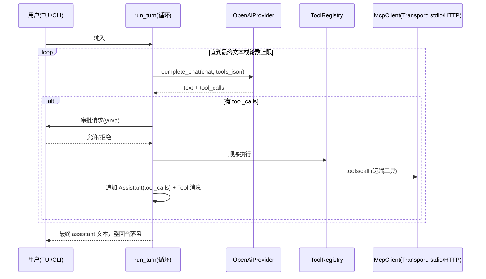

# mini-agent v2 技术方案（工具循环 + 命令执行 + MCP 客户端：传输抽象 + stdio/HTTP）

## 文档状态
- 状态：已实现（M1–M4 全部落地，验证见第 8 节；待人工评审）。第 9 节记录与本文原设计的实现偏差。
- 关联任务：维护者 2026-11-02 提出"考虑这个 agent 如何接入 MCP，从而拥有工具调用或命令执行的能力"；承接 [007 第 5.5 节](007-agent-v1.md) 预留的工具调用扩展点。
- 核对日期与适用版本：2026-11-02 在线核对 MCP 官方规范版本化页面（`specification/2025-06-18` 的 Key Changes / Lifecycle / Transports 含 Streamable HTTP 会话与头部细则，`specification/2025-03-26` 的 Transports（stdio） / Tools）。协议基线选定 **2025-06-18**，兼容回退 **2025-03-26**（不使用 batching，两版通用；HTTP 的 `MCP-Protocol-Version` 头仅 06-18 会话需要）。代码基线：main@087e9ac（v1 已实现）。
- 人工评审记录：无。AI 不得自行标记评审通过。

## 1. 背景与目标

v1 明确排除 tool calling，只做了格式预留（`Role::Tool`、`Message.tool_call_id`、"失败轮不留脏历史"的单次 `run_turn`）。v2 的目标是让模型能自动发现并调用工具，具体能力诉求：

1. **工具调用循环**：模型返回 tool_calls → 内核执行 → 结果以 Tool 消息回填 → 再次请求，直至模型给出最终文本。
2. **命令执行**：内置 `run_bash` 工具，人审通过后以进程用户权限执行 shell 命令。
3. **接入 MCP**：作为 MCP 客户端连接标准 MCP server，**同时支持 stdio 与 Streamable HTTP 两种传输**（维护者 2026-11-02 要求：HTTP server 必须支持，且协议数据与传输方式解耦，任何 IPC 载体理论上均可承载）；server 的 `tools/list` 自动进入同一注册表。

成功判据：TUI 中模型可完成"列目录 → 执行命令 → 汇总"任务且每一步可人工否决；配置一个官方 Node stdio server 与一个 Streamable HTTP server 后 `/tools` 均可见并可被调用；不新增第三方依赖；无 MCP 配置时冷启动与 v1 行为完全一致。

## 2. 范围与非目标

本期（v2）交付：

- Provider 层：请求体 `tools` 数组、流式 `delta.tool_calls` 分片累积（OpenAI 兼容协议）。
- 内核：多轮工具循环（`run_turn` 内层循环，轮数上限可配）。
- Chat/session：`Message.tool_calls` 字段与序列化；含工具消息的 session 文件 `schema_version` 升 2。
- `tools.hpp`：ToolRegistry 抽象（内置工具与 MCP 工具统一形态）。
- 内置工具：`run_bash`（命令执行），审批策略默认逐次人工确认。
- MCP 客户端（传输抽象 + 双实现）：与传输无关的 JSON-RPC/对话层内核 + `StdioTransport`（子进程 spawn、换行分隔 JSON-RPC）+ `HttpTransport`（Streamable HTTP POST/SSE、`Mcp-Session-Id`、`MCP-Protocol-Version` 头）；`initialize` / `notifications/initialized` / `tools/list` / `tools/call`；远端工具包装进注册表。
- 配置：`config.json` 新增 `mcp_servers`、`tool_approval`、`allowlist`、`max_tool_rounds` 等字段。
- CLI/TUI：工具活动行进历史区、内联确认、`/tools`、`ask` 的授权开关。

非目标（明确排除，后续另出设计）：

- resources、prompts、sampling、elicitation、roots、progress token；HTTP 侧 OAuth 授权流程（**维护者 2026-11-02 确认"目前不做企业 OAuth"**，认证仅静态 Bearer）与服务器发起请求（`Mcp-Session-Id`/SSE 响应解析除外）。自定义 IPC 传输不在本期交付，仅保证抽象接口可挂。
- mini-agent 自身作为 MCP server 对外暴露。
- 并行 tool_calls（v2.0 顺序执行）。
- Windows/macOS 特殊进程管理（目标平台按 006 为 Linux 为主，POSIX fork/exec 通用）。

## 3. 约束与参考资料

项目约束（必须遵循）：

- 不无故新增依赖；新增前核实许可证并记 ADR（AGENTS.md）。本设计**不引入新依赖**：JSON 用已 vendor 的 nlohmann/json，HTTP 已有 libcurl（未来 HTTP transport 才可复用），进程管理用 POSIX fork/exec/pipe（与 ADR 003 自绘 TUI 同款"手写最小实现"取向）。
- ADR 001 进程模型不变：一进程一会话；MCP 子进程是该会话的从属资源，随主进程退出回收。
- 日志红线不变（[007 第 6 节](007-agent-v1.md)）：只记元数据（工具名、时长、字节数、状态），**绝不**记命令内容、参数 JSON、工具输出正文、server stderr 原文。
- 用户可见文案英文；中文仅限设计文档（development.md 约定）。

外部 API 事实（必须核对项，已于 2026-11-02 在线核对，来源为官方版本化文档）：

- 传输：MCP 消息为 JSON-RPC 2.0，UTF-8。stdio 传输中客户端把 server 作为子进程启动，消息以**换行分隔且不得内嵌换行**；server 的 stdout 只允许出现合法 MCP 消息，stderr 可自由写日志；客户端向 server stdin 只写合法 MCP 消息。（2025-03-26 Transports）
- 生命周期：`initialize`（携 `protocolVersion`/`capabilities`/`clientInfo`）→ server 回 `capabilities`/`serverInfo`/可选 `instructions` → 客户端必须补发 `notifications/initialized`；版本不一致时 server 返回其支持版本，客户端不支持则应断开。（2025-06-18 Lifecycle）
- 工具：server 声明 `tools` capability；`tools/list` 返回 `name`/`description`/`inputSchema`（可选 `annotations`，规范要求客户端**视为不可信**）；`tools/call` 参数 `{name, arguments}`，结果 `content[]`（可多段，类型含 text）与 `isError`。（2025-03-26 Tools）
- 2025-06-18 相对 2025-03-26：移除 JSON-RPC batching、新增 structured tool output / elicitation / resource links、HTTP 后续请求必须带 `MCP-Protocol-Version` 头。（2025-06-18 Key Changes）
- 规范原文还要求"人审在环"：客户端 SHOULD 提供确认与可视化提示（Tools 页 WARNING 节），与本文默认 `tool_approval = ask` 对齐。

设计参考（不要求照搬）：

- [agent-protocols.md](../references/agent-protocols.md)：MCP 工具契约与能力协商；本次核对结论已回写其"实际采用情况"。
- [coding-agents.md](../references/coding-agents.md)：Goose 早期 MCP 集成形态；Pi "刻意保持内核小"的论证支持本文"只做 tools 面、不碰 resources/prompts/sampling"的裁剪。只取模式，不复制代码（各仓库源码仍未精读）。
- [cli-as-tools.md](../references/cli-as-tools.md)（2026-11-05 登记）："全量注入 schema"的 token 成本论证与两条替代路线（MCP→CLI 按需发现、Code Mode）。本文 §2 将 progressive disclosure 列为非目标的前提是当前小规模下成本低于复杂度；若 v3 松动该裁剪，按需加载 schema / `search_tools` 元工具两种成熟形态见该文件，Code Mode 因需沙箱执行环境与项目约束冲突不在射程。

本地差异：官方生态以 TS/Python SDK 为主，本项目是原生 C++ 单二进制，无官方 C++ SDK（社区 SDK 许可证与维护状态未核实，不引入），故按协议文本自写最小客户端（预估数百行，单请求串行）。
- MCP client/server 开源实现参考组（2026-11-05 登记，元数据+许可证层核对，源码未精读、无代码借鉴）：官方 SDK 组（TS/Python/Go/Java/Rust/C#/Swift，MIT→Apache-2.0 过渡）、官方 inspector（client 调试器）、C++ 社区实现（gopher-mcp=Apache-2.0、cxxmcp=MIT 等，其中 conformance-tested 项目是未来对本客户端做外部一致性验收的候选工具）、mcp-go=MIT/rust-mcp-sdk 等高星社区实现、deepwiki 公开 server（真实对端行为已记录）。清单、许可证与用途定位见 [references/agent-protocols.md](../references/agent-protocols.md)。

## 4. 方案与关键取舍

| 取舍 | 选定方案 | 主要备选 | 理由 | ADR |
| --- | --- | --- | --- | --- |
| 工具来源协议 | 统一 ToolRegistry + MCP stdio 客户端 | A：仅自研私有工具协议（无 MCP）；B：一切工具皆 MCP（连 shell 也内嵌一个 mini server） | A 无生态复用；B 多一层子进程与启动复杂度。C（选定）内置工具直挂注册表、外部工具经 MCP，循环层对两者无感知 | [005](../decisions/005-mcp-transport-abstraction.md) |
| 客户端实现 | 按规范自写最小客户端，**RPC 内核与 Transport 抽象分层**，首批 stdio + Streamable HTTP 双实现 | 社区 C++ MCP 库；stdio/HTTP 各写一套耦合实现 | 库的许可证/质量未核实；分层后协议逻辑单点维护，新 IPC 载体只加实现类（维护者扩展性要求）；与 ADR 002/003 一致 | 同上 |
| 命令执行与安全 | 内置 `run_bash` + 默认逐次人工确认 | 自动放行、allowlist 起步、不提供 shell | MCP 规范本身要求 human-in-the-loop；mini-agent 无沙箱，"无内置权限系统"边界声明延续到工具时代 | [006](../decisions/006-tool-approval-policy.md) |
| session 兼容 | 出现 tool 消息即写 `schema_version = 2`（v1 读到更高版本会拒绝） | 保持 1、依赖 forward-read | forward-read 只保证"能解析"，不保证"重放正确"：v1 会丢 `tool_calls` 而留下孤儿 Tool 消息，发给模型必错。fail-closed 拒绝更诚实 | — |
| 失败回滚语义 | "多轮工具回合"整体仍只在结束时落盘；执行过的工具**副作用不回滚** | 每步中间落盘 | 保持 007"不留脏历史"不变量于消息层；副作用不可事务化是客观限制，如实声明（第 6 节） | — |

发布切三个里程碑，各自可独立合入与验证：

- **M1 内核协议**：`CompletionResult{text, tool_calls}`、Provider tools 请求/流式解析、`run_turn` 多轮循环、Chat/session v2、单测。无注册表时行为与 v1 逐字节一致。
- **M2 内置工具与人审**：ToolRegistry、`run_bash`、审批回调、TUI 历史区/确认行、`ask --tools`、pty smoke。交付"命令执行"能力。
- **M3 MCP 客户端（stdio）**：`McpTransport` 抽象、JSON-RPC 内核、`StdioTransport` 子进程管理、`mcp_servers` 配置、远端工具包装、mock stdio server E2E。交付"接入 MCP"能力（stdio 面）。
- **M4 MCP 客户端（HTTP）**：`HttpTransport`（POST/SSE、会话头、协议版本头、静态 Bearer）与 mock HTTP MCP server E2E。交付"接入基于 HTTP 的 MCP server"。M4 依赖 M3 抽象就位，可与 M2 并行设计、串行合入。

## 5. 详细设计

### 5.1 数据流



### 5.2 模块与文件布局（规划中，均为新文件/新增字段）

- `include/mini_agent/tools.hpp` + `src/tools.cpp`

```cpp
struct ToolDefinition {           // 注册表条目（wire 无关的中立形态）
    std::string name;             // 全局唯一，^[A-Za-z0-9_-]{1,64}$
    std::string description;
    std::string input_schema_json; // 原样转发给模型的 JSON Schema（不透明）
    std::string source;           // "builtin" | mcp server 名
};
struct ToolCall { std::string id, name, arguments_json; };
struct ToolResult { std::string text; bool is_error = false; };

class ToolRuntime {               // 每类来源一个实现
  public:
    virtual std::vector<ToolDefinition> list() = 0;
    virtual ToolResult call(const ToolCall&, const ShouldAbort&) = 0;
};
class ToolRegistry { /* 聚合多个 runtime；重名消歧；产出 OpenAI tools JSON */ };
```

- `include/mini_agent/mcp.hpp` + `src/mcp_rpc.cpp`：**与传输无关的两层内核**。`McpTransport` 抽象接口：`send(json)`（投递一条完整 JSON-RPC 消息）、`recv(timeout)`（弹出下一条消息，或超时/断链错误）、`close()`；分帧与到达模型是实现的私事——这一抽象同时容纳 stdio 的异步字节流与 HTTP 的"响应内联于请求"（HTTP 实现内部自排队列，`recv` 从队列出队）。`McpRpcClient`：单调递增 id、串行 in-flight、超时与错误折叠（通知失败不报错；服务端发起请求在 v2.0 忽略并记日志事件）。`McpClient`（对话层）：`initialize`/版本协商/`notifications/initialized`、`list_tools`、`call_tool`。`inputSchema` 不校验 arguments，原样透传（server 是最终裁判，`isError` 回填给模型自纠）。
- `src/mcp_stdio.cpp`：`StdioTransport`——`pipe×3` + `fork` + `execvp`（子进程侧 `_exit` 语义与 fd 收敛）；换行分隔 JSON，发送前拒绝内嵌裸换行，接收行上限 1 MiB 超限即协议错误；`stop()` = 关 stdin → `waitpid` 限时 → `SIGKILL`；stderr 只收集为诊断事件。
- `src/mcp_http.cpp`：`HttpTransport`（Streamable HTTP）——每条消息一个 `POST {url}`，`Accept: application/json, text/event-stream`；响应 `application/json` 直接入队，`text/event-stream` 复用 provider 的 SSE 分行器解析至匹配本请求 id 的 response 为止；通知/响应类 POST 收 202 即成功；`initialize` 响应捕获 `Mcp-Session-Id` 并在后续所有请求携带（收 404 → 重走 initialize）；协商版本为 2025-06-18 时后续请求必须带 `MCP-Protocol-Version` 头。认证 v2.0 只支持配置的静态 Bearer token（维护者 2026-11-02 确认不做企业 OAuth，发现 401 + `WWW-Authenticate` 时如实报错提示，不进入授权流程）；不监听服务器发起的常开 GET 流。libcurl 复用 ADR 002 底座，零新依赖。
- 内置 `BuiltinRuntime`（`src/tools.cpp` 内）：`run_bash{command, timeout?}` → `fork/exec` `/bin/bash -lc <command>`（argv 固定，不经二次拼接）；捕获 stdout+stderr 合并、默认 30 s 超时、输出截断 32 KiB（保留首尾各半，中间注明截断）；`ShouldAbort` 触发 `SIGKILL` 进程组。
- `provider.hpp`：新增

```cpp
struct CompletionResult { std::string text; std::vector<ToolCall> tool_calls; };
virtual CompletionResult complete_chat(
    const Chat&, const std::string& tools_json, on_delta, ShouldAbort);
// 默认实现转调 complete()，返回纯文本 —— v1 测试与第三方 Provider 不受影响
```

  `OpenAiProvider`：`tools_json` 非 `"[]"` 时请求体加 `"tools"` 数组（由 Registry 把中立形态映射为 `{type:"function", function:{name, description, parameters}}`）；SSE 解析在 `delta.tool_calls[]` 上按 `index` 累积 `id`/`function.name`/`function.arguments` 分片，`finish_reason == "tool_calls"` 时收尾。`on_delta` 只转发 `content` 文本，工具分片不刷屏（借鉴 007 §5.6 事件/渲染分离）。
- `chat.hpp`：`Message` 增 `std::vector<ToolCall> tool_calls`（沿用"空则省略"写出规则）；`chat_to_json` 的存储形态为 `{id, name, arguments}`（自有中立格式），由 Provider 映射为 OpenAI 线上格式，session 文件不绑定厂商形状。`tool` 角色消息必须携带 `tool_call_id`（写侧校验）。
- `session.cpp`：序列化含任一 tool_calls/tool 消息时 `schema_version = 2`；读侧 v2 文件在 v1 构建中按既有"更高版本拒绝"路径给出升级提示（该行为 v1 已实现，需补契约测试）。
- `loop.hpp/cpp`：扩展签名（带默认值，旧调用点不改编译）：

```cpp
struct TurnOptions {
    ToolRegistry* tools = nullptr;          // null = v1 单发行为
    std::size_t max_rounds = 8;             // 配置可调
    std::function<Approval(const ToolCall&)> approve; // M2
};
```

  循环体：Provider 返回 `tool_calls` → 逐个审批/执行/追加消息 → 再请求。工具名未命中注册表：合成 `is_error` 的 Tool 消息回填（给模型自纠机会），不抛异常。审批被拒同样回填 error Tool 消息。达到 `max_rounds`：追加一条 system 注记请求总结（或按配置直接报错退出），防无限循环。

### 5.3 配置（config.json 新增，env 覆盖规则不变）

```json
{
  "mcp_servers": {
    "fs":   { "transport": "stdio", "command": "npx", "args": ["-y", "@modelcontextprotocol/server-filesystem", "/tmp"], "env": {} },
    "docs": { "transport": "http", "url": "https://127.0.0.1:8932/mcp", "bearer_token": "" }
  },
  "tool_approval": "ask",            // ask | allowlist | off(等同危险 yolo)
  "tool_allowlist": ["run_bash"],    // allowlist 模式按名放行
  "max_tool_rounds": 8,
  "tool_timeout_seconds": 30
}
```

  **会话级注入（2026-11-04 维护者需求）**：`ask`/`run`/`mcp list` 支持重复 `--mcp NAME=SPEC`，三种形式——`NAME=https://host/mcp`（或 http loopback）、`NAME=command arg1 arg2`（stdio，空白拆分；参数含空格改用 JSON 形式）、`NAME={...}`（与 config.json 条目同 schema）。NAME 限 `[A-Za-z0-9_-]{1,32}`（进工具名）；经同一 `valid()` 门校验；同名覆盖文件条目、不写回文件（重启即失）。`mcp list` 子命令打印合并后的 server 清单，bearer 恒显示 `set`、URL 过 `redact_url`，未配 LLM 也可运行。

  超时归属（实现核对 2026-11-05）：`tool_timeout_seconds` 是 **run_bash** 的默认命令超时；MCP 调用超时目前为固定值（stdio 握手 10s/调用 120s，HTTP 传输 curl 上限 120s），**未按 server 可配**——列为后续项（§9）。审批等待另有 120s 自动拒绝保护（§6）。

  `transport` 出现 `url` 且缺省时按 `http` 推断并告警，其余缺省为 `stdio`。http 的 `bearer_token` 与 api_key 同级对待：0600 配置文件、绝不入日志、env 不提供覆盖入口；默认只允许 `https://` 或 `http://127.0.0.1`/`localhost`，明文远端需显式 `allow_insecure_http: true`。env 覆盖仅 `MINI_AGENT_TOOL_APPROVAL`；`MINI_AGENT_NO_MCP=1` 全禁 MCP（排障用）。stdio server 的 `env` 显式声明才透传，另固定提供 `PATH`/`HOME` 基线；**绝不**把 `MINI_AGENT_API_KEY` 带入子进程。

### 5.4 CLI / TUI 交互（文案英文，遵循 007 §5.6 帧模型）

- 历史区新增工具行：`[tool] run_bash · ls -la …(截断 1 行)` → `[ok 0.4s · 1.2 KB]` / `[error …]`；MCP 远端显示 `[tool] fs/read_file`。
- 确认行内联在 composer 上方：`allow 'run_bash': ls -la /etc [y/N/a/?]`——`y` 本次、`n` 拒绝并回填告知模型、`a` 本会话同工具名免问、`?` 展开完整参数 JSON。Esc/Ctrl-C = n。streaming 期间输入语义不变。
- 斜杠命令新增 `/tools`（列出注册表条目与来源、server 在线状态）、`/mcp`（列 server、重启子进程）。`/config` 增 `approval=` 行。
- 子命令 `mcp list`：打印 env+file+`--mcp` 合并后的 server 清单（bearer 恒 `set`、URL 过 redact_url），不要求 LLM 配置完整，作为配置自检入口。
- `ask`：新增 `--tools off|ask|auto`，默认 `off`（保持非交互脚本的确定性契约与退出码语义）；`ask` 模式要求 TTY，否则等同 `off` 并 stderr 提示。
- TUI 默认 `ask` 走 config；`off` 模式在状态行常显黄色 `auto-tools` 警示。
- 工具输出与 MCP 返回文本渲染前**必须**过滤控制字符（含 ESC）：现 TUI 行预算假设输入无转义（`tui.hpp` 纯函数层），新增 `sanitize_display(std::string_view)` 纯函数并入 agent_test。

### 5.5 启动与生命周期（对齐"快速启动"第一目标）

MCP server **惰性启动**：首次出现非空 tool_calls 需要远端执行时才 spawn（Node 系 server 冷启数百 ms–秒级，不能进 `--help`/首 token 路径）。`tools/list` 结果进程内缓存；`list_changed` 通知 v2.0 不消费（下次回合重拉，或 `/mcp` 手动）。spawn 失败或握手超时（默认 10 s）：该 server 标记 down，历史区一行提示，其工具从注册表剔除，不影响会话继续。主进程退出路径（含异常）经 RAII 统一 `stop()` 全部子进程。

## 6. 异常与安全设计

- **信任边界**：MCP server 的 name/description/inputSchema 原样进模型上下文 = 不可信注入面；`annotations` 完全不消费（规范明令视为不可信）；server `instructions` 不自动注入 system prompt，仅记日志（评审问题 R1）。工具输出回灌模型前截断并加来源标记。HTTP server 额外面：裸 HTTP 的凭据/内容泄露由上述 `allow_insecure_http` 显式开关顶住；`bearer_token` 复用 api_key 的日志脱敏与掩码显示规则（`/config` 只显示 `set`）。
- **人审默认**：`tool_approval` 默认 `ask`；`off` 必须在 config 显式写出且文档标注"等同于给模型 shell 权限，建议容器/最小权限运行"（延续 architecture"无内置权限系统"声明）。
- **进程管理失败面**：exec 失败（EOF/权限）、stdout 非法 JSON、超长行、无响应、子进程崩溃/僵死 → 全部折叠为 `is_error` Tool 结果或 server-down 状态，绝不使主循环崩溃；`waitpid` 回收在所有路径执行。
- **副作用不可回滚**：回合失败仍不落盘消息，但已执行命令的系统效果保留（rm 不会被撤销）。历史区在失败行标注本回合已执行的工具清单，作为人工复核线索。
- **资源上限**：轮数 `max_tool_rounds`、单工具输出 `tool_output_limit`、arguments 字节上限、单 server 一行缓存上限。防"模型自我循环烧 token"优先于灵活性。
- **审批不得永久阻塞 worker**（实现期补充，2026-11-04）：主线程 120 秒无按键自动按拒绝处理并产生 `[denied] approval timeout` 历史行；审批期间 Ctrl-C/Esc 立即拒绝+中断。
- **日志**：新增事件 `mcp_start/mcp_tools/mcp_call/tool_exec/tool_approve`，字段仅 name/status/elapsed_ms/bytes/rounds；审批内容、命令文本、工具输出不入日志（Logger 既有红线，单测锁死）。

## 7. 兼容性与发布

- 无 MCP 配置 + `--tools off` 时，请求体、落盘格式、TUI 行为与 v1 逐字节一致（回归测试断言）。
- session v1 文件被 v2 正常读取（无 tool 消息即不升级）；v2 文件被 v1 读取走既有"更高 schema_version 拒绝"。
- config 新字段对旧版本是 forward-read 忽略项，不破坏 v1 读 v2 配置。
- 回滚：删配置字段即可，代码层 M1 默认参数路径与 v1 同形。
- 命名空间双下划线是**破坏性可见变化**（相对设计稿示例 `fs/read_file`）：外部脚本若按设计稿解析工具名，以实现为准（`server__tool`）。
- 观测：状态行 `tools:N` 计数 + 日志事件；无遥测。

## 8. 验证情况

设计阶段，全部未执行；下表为实现时的验收计划。

| 验收项 | 测试位置或证据 | 实际执行命令 | 结果 | 限制 |
| --- | --- | --- | --- | --- |
| 中立 tool_calls 序列化/反序列化往返（含旧文件兼容） | agent_test.cpp `test_tool_calls_round_trip` | `./build/linux-gcc-debug/agent_test` | 通过 | — |
| session v1↔v2 升降规则、更高版本拒绝 | agent_test.cpp `test_session_schema_bumps_for_tools` | 同上 | 通过 | — |
| 无工具请求体与 v1 逐字节一致 | agent_test.cpp `test_v1_request_shape_regresssion`（provider 导出 test hook） | 同上 | 通过 | — |
| SSE `delta.tool_calls` 分片累积 + 网关形状兼容 | mock_openai_server.py TOOLTEST/VARFLAT/VARFC/VAROBJ/VARQWEN/VARMSG/BADSHAPE 剧本 | `python3 tests/mock_openai_server.py 18941` + `mini-agent ask --tools auto "<剧本>"` E2E | 通过 | 覆盖 6 类已知形状（含 qwen 空占位流）；其余形状触发结构指纹错误（偏差 D3） |
| 工具循环上限/未命中工具/审批拒绝/中途失败不落盘 | agent_test.cpp `test_tool_loop_rounds_and_commit`、`test_max_tool_rounds` | `agent_test` | 通过 | — |
| run_bash：输出/退出码/超时杀进程组/参数 fail-closed/截断 | agent_test.cpp `test_run_bash_and_helpers` | `agent_test` | 通过 | — |
| MCP RPC/对话层（握手、版本协商回退、foreign 消息跳过、isError、down 标记、restart、list 缓存） | tests/cpp/mcp_test.cpp（FakeTransport 脚本） | `./build/linux-gcc-debug/mcp_test` | 通过 | — |
| stdio 真子进程 E2E（initialize→list→call）+ 秒退子进程无僵尸 | mcp_test.cpp + tests/mock_mcp_server.py | 同上（ctest `mcp.client`） | 通过 | 真实 Node server 另行人工验证 |
| `--mcp` 会话注入三形式、NAME 校验、同名覆盖、`mcp list` 脱敏 | agent_test.cpp `test_mcp_cli_specs`；`ask --mcp` + mock http server（INJECT 剧本）E2E | `agent_test` / 手工 E2E | 通过 | JSON 形式复用文件解析路径（单一实现） |
| HttpTransport：SSE 与 JSON 响应、`Mcp-Session-Id` 捕获/携带、Bearer、fail-closed 校验 | mcp_test.cpp `test_http_transport_round_trip` + tests/mock_mcp_http_server.py | `mcp_test` | 通过 | 404 重初始化由 restart 路径覆盖；真实公网 server 未测 |
| 控制字符注入 TUI 被 sanitize | agent_test.cpp（sanitize_display、tool_activity_line 断言） | `agent_test` | 通过 | — |
| 日志红线（工具参数/输出不入日志） | CLI on_tool 事件仅 name/status/ms/bytes；结构指纹仅字段名+类型 | 代码走查 + `agent_test` | 通过 | — |
| 全量门禁 | scripts/cpp_check.py | gcc-debug / gcc-release / clang-debug 各含 ctest；`--tidy --warnings-as-errors`；`--sanitizers` | 通过 | clang-release 未跑（工具链矩阵其余组合） |
| pty 端到端（v1 交互契约回归） | tests/pty_tui_smoke.py | `python3 tests/pty_tui_smoke.py ./build/linux-gcc-debug/mini-agent` | 通过 | v2 审批流的 pty 断言待补（偏差 D4） |
| 真实网关 E2E（deepwiki MCP + qwen） | 维护者本机 2026-11-04 | 手工：`/tools` 列出 4 工具、握手成功 | 部分 | qwen 流式形状触发偏差 D3，见第 9 节 |

## 9. 实现偏差与已知限制

实现偏差（2026-11-04，以代码为准）：

- D1：MCP 工具命名空间分隔符由设计稿的 `server/tool` 改为 `server__tool`，并对 server 原始名做 `[A-Za-z0-9_-]` 净化、`tools/call` 时映射回原名。原因：OpenAI 兼容协议 function name 只允许该字符集，带 `/` 的名字被网关静默忽略导致空回复（deepwiki 实测 2026-11-04）。config 同时校验 server 名只含合法字符。
- D2：`ToolResult` 增加 `elapsed_ms`（循环层计时），UI 行与日志需要时长。
- D3：Provider 对不认识的工具流形状不再静默交付空回复，改为携带**结构指纹**（仅字段名+类型，无值）的协议错误（R2 的运行时兜底）；同时兼容三类已知网关变体：flattened fragments（`call_id`/顶层 name/arguments）、arguments 预解析对象、legacy `delta.function_call`。qwen 真机已收敛：结构指纹显示其兼容端点先以**空字符串占位**下发 id/name（片段还带 `type` 字段），后续片段才填真实值——累积器此前会被空占位覆盖。已改为非空才写入，并兼容 message 级完整 `tool_calls` 交付；mock 新增 VARQWEN/VARMSG 剧本 E2E 通过（2026-11-04）。错误信息同时输出 `slots=id长度/name长度/args长度` 诊断（仅长度，无值）。
- D4：审批 UI 的 worker/主线程桥接用固定槽位 + 序号协议实现（无悬垂指针）；pty smoke 的 v2 审批断言未补，当前以单元/E2E 覆盖。
- D5：`ToolRegistry::add()` 初版实现同步调用 `runtime->list()` 认领名字，违反 5.5 惰性启动——配置 HTTP MCP server 后 TUI 首帧被握手阻塞（维护者 2026-11-04 报告"启动很慢"）。已修复：add 不再 list，名字认领推迟到 `list()` 内（late-registered 路径已覆盖），`find()` 直接扫 runtime；修复后带 deepwiki 配置的首帧 6ms（pty 实测）。回归点：任何让启动触网的新调用都必须在 `ensure_started()` 之后。
- D6：CLI `ask --tools ask` 初版在非 TTY 降级为 auto，违背本文 5.4 与 ADR 006（管道里静默执行 shell）。已改为降级 off + stderr 提示，并补 E2E；同时审批提示统一走 stderr 保 stdout 契约。
- 其余按第 5 节实现。

实现评审优化（2026-11-05 全模块回顾，已合入）：

- R-a：`McpClient::list()` 热路径——缓存有效时完全不发网络请求。原实现每回合每次 provider round-trip 都要 `ensure_started()`+可能重列，多轮工具回合每轮多付一次 tools/list RTT；`mcp_test` 新增"重列零流量"断言锁行为。
- R-b：`StdioTransport::close()` 等待期内双向排空管道——防子进程写满 stdout/stderr 阻塞在退出前（EOF 后不再被读）、诊断尾部保持最新。
- R-c：`HttpTransport` 持久 curl handle（`curl_easy_reset` 复用）——同一 server 会话内 keep-alive/TLS 会话复用，远端（deepwiki 类）每调用省一次握手。
- R-d：`McpClient` 头文件写明线程契约（单 owner：CLI 回合内/TUI worker join 边界；list/call/restart 无内部锁），防止未来并发误用。

评审确认的后续项（未动，按优先级）：每 server 可配 `timeout_seconds`（现为固定 120s，已记 §9 限制）；MCP/HTTP 调用执行中可中断（接 `CURLOPT_XFERINFOFUNCTION` 查 abort，run_bash 已有进程组 kill）；allowlist 支持 `dev__*` 前缀匹配；服务器发起的 GET 常开流与 progress；对 cxxmcp/yurirocha15 声明的官方 conformance suite 跑一次本客户端的外部一致性验收（参考已登记 references）；`mcp list --probe` 主动握手显示 down/ok；tool 结果持久化前未过 sanitize（当前仅展示面过滤，重放历史时模型收到原文——风险低，留观）。

评审前待确认的开放问题：


- R1：MCP `instructions` 与 server 注入面——v2.0 采取"不注入"是否过保守？
- R2：OpenAI 兼容服务的 `delta.tool_calls` 分片行为各家有差异（尤其国产网关），属"必须核对"事实，接入前需按当天目标服务实测，已按实现偏差 D3 落地 lenient 解析 + 结构指纹报错；qwen 真机形状待指纹回填后收敛。
- R3：工具输出累积与上下文压缩扩展（007 §5.5）联动，多轮大输出场景暂以截断硬上限顶住。
- R4：`ask` 非交互默认 `off` 是否维持脚本兼容性优先于易用性——需维护者确认。
- 已确认（2026-11-02 维护者批复）：HTTP MCP server 认证**不做企业 OAuth**，静态 Bearer 即够；若未来接入走 OAuth 发现流程的 server，另出设计并升级 [ADR 005](../decisions/005-mcp-transport-abstraction.md)。
- 已知限制：v2.0 串行执行工具、不实现 progress/取消通知（仅本地 Ctrl-C kill）；HTTP 传输已纳入范围但不监听服务器发起的常开 GET 流、不支持 OAuth 发现（仅静态 Bearer）；MCP 每 server 可配超时未实现（当前固定 120s，后续项）；**工具执行中的单次调用不可中断**（HTTP curl 无中止回调；run_bash 已接进程组 kill，MCP/HTTP 调用需等其返回或超时——deepwiki 重查询体验入口 §见 mcp-usage 4）。

## 最终核对
- [x] 接口、配置、路径与当前代码核对一致（基于 main@087e9ac 实读源码）。
- [x] 已实现与规划内容清楚区分（本文全部为规划；仅"更高 schema_version 拒绝"引自 v1 已有行为）。
- [x] 外部来源、版本和实际采用内容可追溯（2026-11-02 官方版本化 URL，见第 3 节）。
- [x] 验证结果如实标未执行。
- [x] 索引与架构总览更新：见 docs/design/README.md、docs/architecture.md、docs/decisions/（本轮随文档一并更新；实现落地后再勾）。
