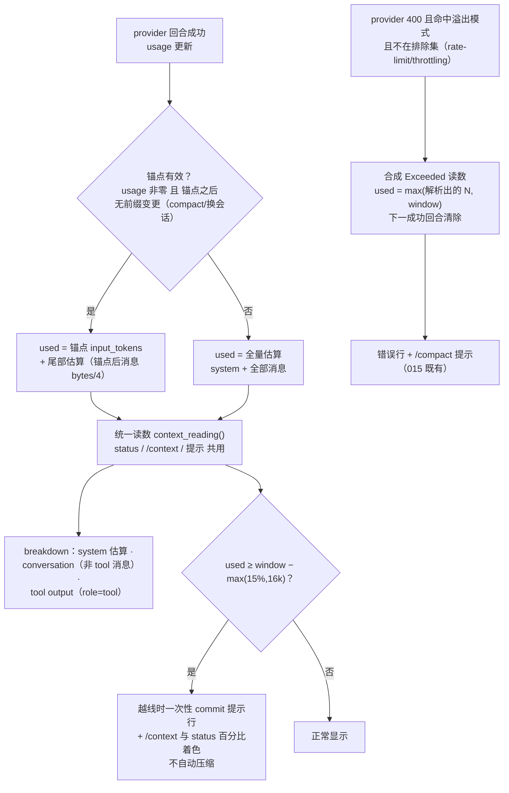
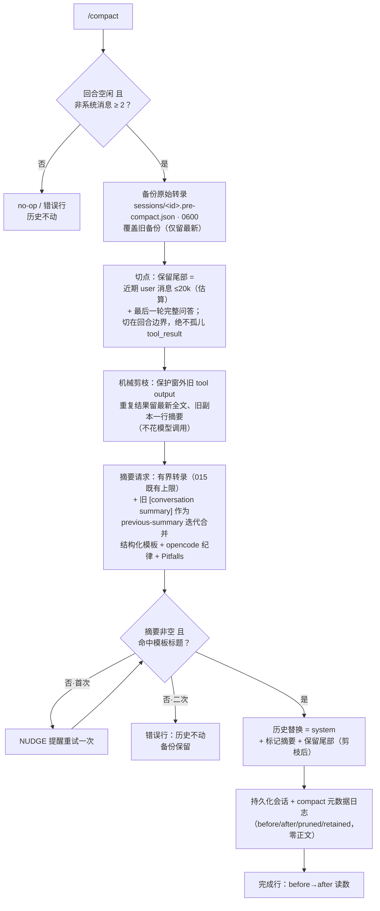
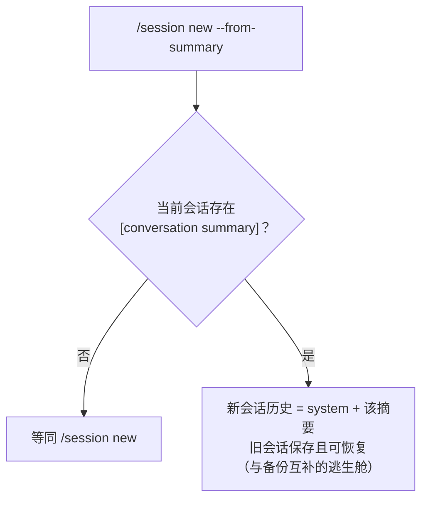

# mini-agent 技术方案 017：上下文管理增强（锚点计量 / breakdown / 压力提示 / /compact 升级）

## 文档状态

- 状态：**草案 / 待人工评审**（2026-11-15）。验证计划见 §6，**尚未执行**，不得视为已实现。
- 关联任务：维护者 2026-11-15 批准的六家调研结论落地（[context-compaction-survey.md](../references/context-compaction-survey.md) §5 采纳清单 1–9）。
- 核对日期：2026-11-15，基于 main `e704c5e`。
- 上游决策：015（手动 /compact、自动压缩非目标）、014（只重试瞬时错误）、010（窗口判定链）。本设计不推翻三者。
- 人工评审记录：维护者指示"对于打算实现的方案，最好提供一个流程图"——本文以 §2 流程图为决策核心；其余契约待评审。

## 1. 目标与非目标

目标（调研采纳项，括号内来源）：
1. 锚点+尾部计量，单一读数函数供 status、/context、提示共用（pi/opencode/codex；治 pi #115 同款多轮跳变）。
2. `/context` 三行 breakdown：system / conversation / tool output（Codewhale）。
3. 混合余量压力提示 `window − max(15%, 16k)`，**只提示不自动**（opencode 表达 + 015 决策）。
4. `/compact` 升级：机械剪旧 tool output → 保留尾部（近期 user 消息 ≤20k + 最后一轮完整问答，不破坏 tool 配对）→ 结构化迭代摘要（Codewhale/codex/pi）。
5. 摘要 prompt 纪律：不复述系统提示、未答问题逐字携带、工作流状态、精确路径/错误串、不提压缩、**Pitfalls 段**；NUDGE 一次重试（opencode/Zed）。
6. 压缩前原始转录备份 `<id>.pre-compact.json`（0600，仅留最新一份；pi/codex 不可变精神的降级版）。
7. 溢出模式集加 NON_OVERFLOW 排除（pi）。
8. 溢出后合成 Exceeded 读数，不显示陈旧 usage（Zed）。
9. 可选扩展（Q3 待确认）：`/session new --from-summary` 以摘要播种新会话（Zed 逃生舱）。

非目标：自动压缩本体、remote/native 压缩、async precompute、hooks、entry-tree、cache-zone、1.5× 双估算器、ACP/GUI 形态。

## 2. 流程图（决策核心）

### 2.1 计量与每回合判定（单一读数函数）

锚点存储：`usage_anchor = {baseline_msg_count, input_tokens}`，每次 `complete_chat` 成功记录当时 `chat.messages().len()`；`Chat::replace` / 会话加载即失效（pi 时间戳失效的 index 版，适配现有 Message 无时间戳的 schema）。估算沿用现有 `estimate_context_tokens`（bytes/4），**不引入第二估算器**。

### 2.2 /compact 管道（失败任何一步 → 历史不动）

与 015 的差异：015 全量替换为单条摘要；017 保留尾部 + 先剪枝 + 迭代摘要 + 备份。015 的 worker/join-then-read 纪律、中断（Ctrl-C/Esc）历史不动、有界转录上限全部沿用。

### 2.3 可选：摘要播种新会话（Q3 待确认）

## 3. 关键契约

- **纯函数**（进 `chat.cpp`/新 `context.cpp`，单测可见）：`context_reading(chat, anchor, window) -> Reading{used, exceeded, breakdown}`；`find_retained_tail(messages, budget) -> cut_index`（回合边界不变量）；`prune_tool_outputs(messages, protected_window) -> pruned`；`overflow_excluded(text) -> bool`。TUI/CLI 只消费读数，不各自算。
- **锚点失效面**：`Chat::replace`、`/session` 加载、`/compact` 替换——三处统一走 invalidate，回归断言覆盖。
- **提示越线**：每个会话每次越线只 commit 一行（状态存 main loop，同 015 compact 状态纪律）；status 尾部百分比在 ≥ 阈值时着警告色（v7.2 保底预算内可裁剪，提示行不依赖 status 宽度）。
- **备份**：与会话同目录、0600、原子写（沿用 session 写纪律）；`session prune`/`rm` 一并清理备份（Q1 待确认保留策略）。
- **日志红线**：compact/overflow 事件仅元数据；备份含完整正文 → 权限同会话文件，不入日志正文。
- **CLI 对齐**：`ask`/line-mode 的溢出提示沿用 015；Exceeded 合成对 CLI 无 meter 不适用，仅 TUI。

## 4. 备选与取舍

- 计量：纯估算（Codewhale 式）被否——锚点处账单级精确且单调；纯 reported 被否——pi #115 跳变。Zed 的"请求内 max"纪律吸收进锚点更新（同回合多次 usage 更新取 max，不累加）。
- 保留尾部预算：codex 20k token vs Zed 80k 字节——选 token（与计量同单位，估算一致），字节方案记为备选。
- 触发表达：opencode 混合 max(15%,16k) 胜出（小窗口不失守、大窗口不浪费）；Zed 三表达（%/+used/−remaining）记为配置面备选，本期不做配置项（Q2）。
- 历史保全：entry-log 投影（pi）被否——schema 变动过大；备份文件是降级中间态，可恢复且零 schema 变化。

## 5. 待确认问题

- Q1：备份仅留最新 vs 全留（默认仅最新；全留会复活 prune 要解决的堆积问题）。
- Q2：压力阈值是否要 env/配置旋钮（默认否，硬编码 max(15%,16k)，同 014 旋钮哲学需要时再加）。
- Q3：§2.3 摘要播种新会话本期做还是后续（默认后续，017 主体不含）。

## 6. 验证计划（未执行）

- 单测：锚点失效三路径；breakdown 分类（tool 消息归属）；切点不孤儿 tool_result（含切在回合中间的扩展用例）；剪枝保护窗逐字节不动；排除集（throttling 文案不判溢出）；阈值数学（小/大窗口）；NUDGE 一次重试。
- pty TUI smoke：/compact 后下一回合可见保留尾部；备份文件存在且 0600；mock 首次返回无模板摘要 → NUDGE 路径；溢出 400 后 meter 显示 Exceeded 而非陈旧值；越线提示行只出现一次。
- 双环境（常规 + `USER=runner-az1234` 宽环境，v7.2 纪律）；四 preset CTest；`check.py --require-initialized`。
- 结果回填本节后经人工评审再实现（workflows/implement-feature.md）。