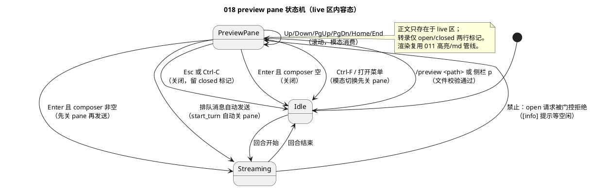
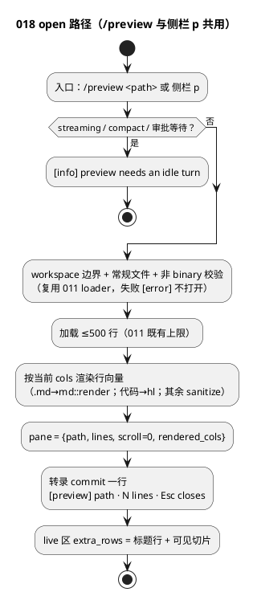

# mini-agent 技术方案 018：预览 pane（live 区内的可关可滚预览视图）

## 文档状态

- 状态：**已实现**（2026-11-15；验证见 §7，偏差 D1 见 §9）；待人工评审。按维护者指示**未提交**，待评审后随实现一并提交。
- 关联任务：维护者 2026-11-15 提议"预览窗口做成单独 TUI 窗口（如 opencode 的悬浮模态）"；经分析悬浮模态与内联架构冲突（见 §1），维护者批准中间路线："先写出设计，先不提交"。
- 核对日期：2026-11-15，基于 main `fbeba72`（含 017 与侧栏 p 清除选择修订）。
- 上游决策：[ADR 003](../decisions/003-tui-approach.md)（内联自绘、**no alternate screen**）、[007 §5.6](007-agent-v1.md)（帧模型与行记账）、[011](011-preview-tui-integration.md)（preview_file / 侧栏 p / 高亮管线）。本设计不推翻 ADR 003。
- 调研旁证：opencode 的悬浮 dialog 是其全屏组件树架构的产物（`packages/tui/src/component/dialog-update.tsx`，见 [ctx-compaction-survey](../references/context-compaction-survey.md) 同期调研）；我们不复刻该形态。

## 1. 背景与取舍

现状（011）：`/preview` 与侧栏 `p` 把文件正文**灌进转录**（≤500 行）。问题：长文件污染 scrollback、不可关、不可滚、预览完即滚走。

opencode 式悬浮模态的收益（聚焦、可关、可滚、不污染转录）真实存在，但其前提是全屏组件树 TUI；我们是内联自绘（转录=终端 scrollback，live 区光标回退差分重绘）。悬浮层需接管全屏 → 丢 scrollback、行记账复杂化（v7.1/v7.2 同类风险）、与流式 live 区互斥、按键状态机与 pty 测试矩阵翻倍——属架构重写，须先 ADR 推翻 003，**不做**。

**选定方案**：preview pane——空闲时把 live 区切换为预览视图（独立滚动、Esc 关闭），转录只留一行标记。复用现有 `extra_rows` live 内容机制与行记账，不引入 alternate screen、不新增记账逻辑。

## 2. 状态机（PlantUML）

## 3. 打开路径（PlantUML 活动图）

## 4. 契约

### 4.1 状态与纯函数

- 主线程状态：`struct PreviewPane { bool open; std::string path; std::vector<std::string> lines; std::size_t scroll; std::size_t rendered_cols; }`；worker 不触碰（同 screen/logger 纪律）。
- 纯函数（进 `tui_render.cpp`，单测可见）：
  - `pane_visible_rows(term_rows)` = max(5, rows − 5)（footer+composer+标题+余量）；
  - `pane_scroll_clamp(scroll, total, visible)` → [0, max(0, total−visible)]；
  - `pane_header(path, scroll, visible, total)` → `[preview] path (L<a>–L<b> of N) · ↑/↓ scroll · Esc close`（≤cols−1，v7.2 守卫）。
- 加载器从 `preview_workspace_file` 抽出为 `load_preview_lines(path) -> (lines, error)`，边界/binary/上限语义与 011 逐字一致；原 lambda 改为"校验→开 pane"。

### 4.2 渲染与行记账

- pane 打开且空闲时 `extra_rows` = 标题行 + `lines[scroll .. scroll+visible)`；**优先级**：审批块（不可能共存，门控）> pane > slash hints（沿用 `hint_source = extra_rows` 机制）。
- 滚动/开关改变 `extra_rows` → render 输入缓存自然失效（`last_extra_` 比较），无需新记账。
- live 块高度上限沿用 §5.6 规则（≤rows−1、cols−1 行宽守卫）；切片越界由纯函数 clamp 保证。
- 终端 resize：`rendered_cols != cols_now()` 时下一帧重渲染行向量（md/hl 管线重跑，≤500 行成本可接受）。

### 4.3 按键（pane 打开期间，模态优先级同侧栏焦点）

| 键 | 行为 |
| --- | --- |
| ↑/↓ | scroll ±1（消费，不做历史召回） |
| 鼠标滚轮 | scroll ∓3（SGR 1000+1006，仅 pane 打开期间启用；其余鼠标事件吞掉） |
| Shift+拖拽 | 终端标准旁路：选择/复制 pane 文本（鼠标上报开启时普通拖拽被应用接管，Shift 恢复原生选择） |
| PgUp/PgDn | scroll ±visible |
| Home/End | scroll 0 / max |
| Esc / Ctrl-C | 关闭 pane，转录 dim 一行 `[preview] closed: path`；不升级退出 |
| Enter | 先关 pane；composer 非空则按正常 Enter 发送，空则仅关闭 |
| 其他可打印字符 | 进 composer（可边读边写下一问）；slash hints 被 pane 抑制 |
| Ctrl-F / 菜单打开 | 先关 pane 再执行原动作 |

### 4.6 侧栏单级浏览器（018，取代两级树）

侧栏聚焦后列表为当前目录的单级内容：`./`、`../` + 排序后的非隐藏条目（文件/目录），存绝对路径；git "changed:" 区保持仓库级、不受影响。

| 键 | 行为 |
| --- | --- |
| ↑/↓ | 选择条目 |
| Enter | 目录/`./`/`../` → 进入并重扫（保持焦点）；文件 → 插入相对路径并退出焦点 |
| `i` | 插入选中项（文件或目录）相对路径给模型，退出焦点——Enter 改为导航后，目录仍可用 `i` 交给模型 |
| `p` | 文件 → 开 pane；目录 → 进入 |
| Esc | 退出焦点 |

浏览目录（`sidebar_browse`）独立于 workspace；`/cwd` 重绑时重置为 workspace 根。预览解析根：仓库内条目用 repo_root，其余用当前浏览目录。

- `start_turn`（含排队自动发送）开头若 pane.open → 关 pane + closed 标记（流式需要 live 区）。
- 门控：`streaming || compact_running || approval_pending()` 时 open 请求 → `[info] preview needs an idle turn · wait or Ctrl-C`，不打开。

### 4.4 转录与日志

- 转录仅两行标记：open（`[preview] path · N lines · Esc closes`）与 closed（dim）。**正文不再进转录**（011 行为变更，§6 修订注记）。
- 日志元数据：`preview_open {path, lines}` / `preview_close {path}`；零正文红线不变。

### 4.5 入口语义变更

- `/preview <path>`：从"灌转录"改为"开 pane"；参数/校验/错误文案不变。
- 侧栏 `p`：开 pane（替代 011 的灌转录）；**p 后清除选择**的 017 修订语义保留。
- `preview_file` 工具（模型侧）不变：正文仍走 UI 预览通道——其 transcript 回显是否改 pane 留 Q3（默认不变，工具回显保持 011 形态，避免模型回合中模态冲突）。

## 5. 非目标

alternate screen / 全屏悬浮模态（ADR 003 保留）；streaming 期间预览；鼠标；新语法高亮；>500 行加载（Q2）；pane 内搜索。

## 6. 文档同步（实现时）

- [011](011-preview-tui-integration.md) 追加修订注记：正文灌转录 → pane；侧栏 p 语义链更新。
- [parameters.md](../parameters.md) §5.2 `/preview` 行、§5.4 Ctrl-F 行、新增 pane 按键表。
- [usage.md](../usage.md) 预览小节。

## 7. 验证（2026-11-15 已执行）

- 单测：`test_pane_helpers` 8 断言（visible rows 24→19/极小终端 floor 5；scroll clamp 末页/短文件/范围内；header 首页/末页/空文件范围 + cols−1 宽度守卫）。
- pty TUI smoke：**193 PASS / 0 FAIL**，常规与 `USER=runner-az1234` 宽环境各一遍。新增断言：pane header 范围（L1–L2 of 2 / of 30）、Down 滚动（L2–）、**鼠标滚轮上/下**（SGR 64/65）、Esc 关闭留 closed 标记、关闭后新帧不含正文（body 从未进转录）、侧栏 p 开 pane + 清除选择 + Esc 关 + Ctrl-F 重新聚焦、streaming 中 open 门控（用 aborted turn 保持历史计数断言不变）。
- 子目录 workspace 回归：从 `build/` 启动时侧栏 changed 区**保留**仓库级条目（docs/…，存绝对路径），预览对仓库根解析不再报 "not a regular file"；界内文件照常（手动 pty 验证）。
- pty CLI smoke：ALL PASS；四 preset CTest 3/3；`check.py --require-initialized` PASS。

## 8. 开放问题

- Q1：是否保留旧"灌转录"形态作旗标（如 `/preview --full`）？默认**不保留**（单一形态，减少状态）。
- Q2：pane 加载上限是否从 500 行提高（如 2000）？默认**保持 500**（与 011 对齐，成本可控），后续按需。
- Q3：`preview_file` 工具回显是否也改 pane？默认**不改**（回合中模态冲突），留后续。

## 9. 偏差

- **D1**：侧栏 `p` 开 pane 时**退出侧栏焦点**（设计原文只说"pane 接管"，实现明确 `sidebar_focus=false`）——否则 ↑/↓ 在 pane 与侧栏间歧义；Ctrl-F 可重新聚焦。smoke 按此语义断言。
- **D2**：侧栏 git changed 区**保留全部条目**（维护者反馈不应删除），路径存**绝对**（`rev-parse --show-toplevel`/file），预览对仓库根解析；树扫描条目仍 workspace 相对。Enter 插入时绝对路径转 workspace 相对。原 "not a regular file" 根因是 git 报仓库根相对路径却被拼到 workspace 子目录。侧栏 p 仅在预览真正打开时才清除选择/提示。
- **D3**：鼠标上报**仅在 pane 打开期间**启用（开/关/退出各发一次 SGR 序列），避免影响平时的终端文本选择；pane 内复制用 **Shift+拖拽**（终端标准旁路，header 有提示）。
- **D4**：侧栏改为**单级目录浏览器**（维护者要求）：`./`/`../` + 当前目录条目，Enter 进入目录；原两级树移除。git changed 区不变。
- **D5**：Enter 进入目录后，新增 **`i`** 作为"把选中路径（含目录）交给模型"的显式键，补回原 Enter 插入目录的能力。