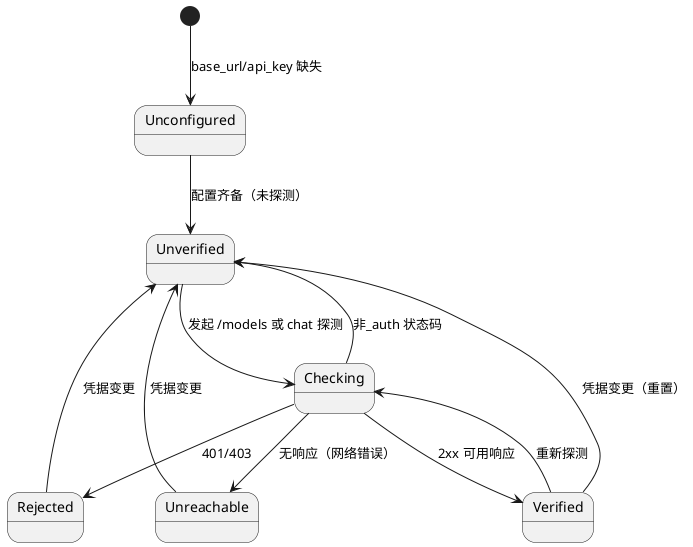
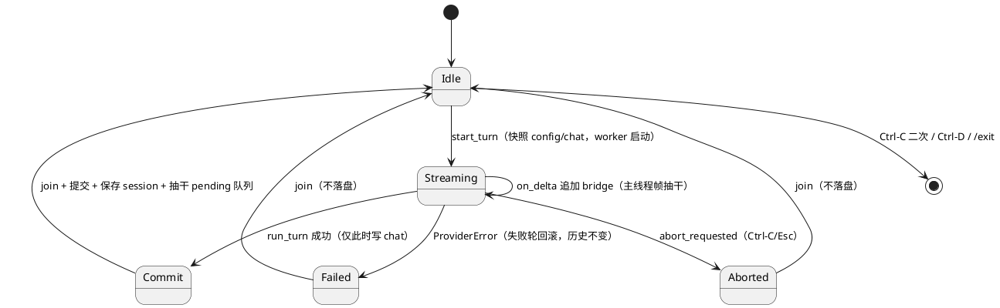
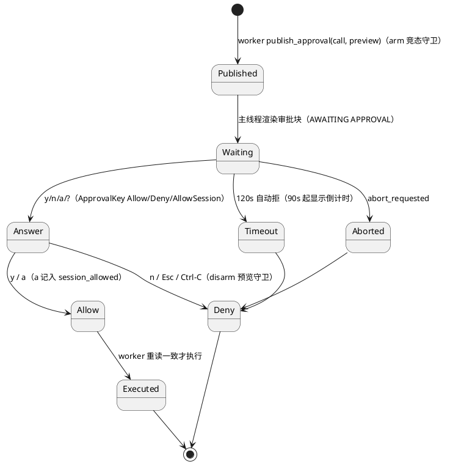
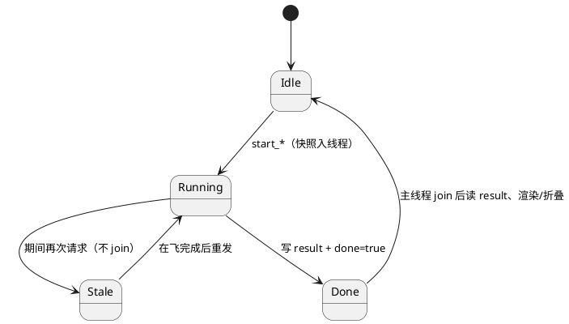
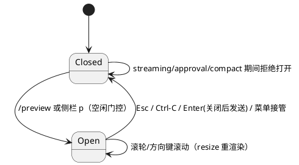
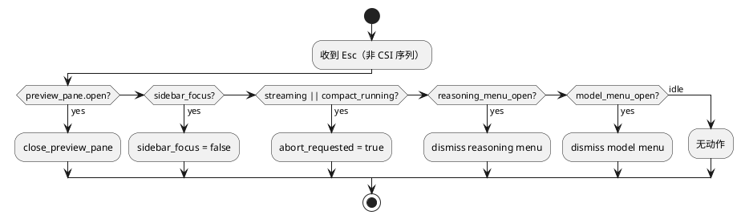
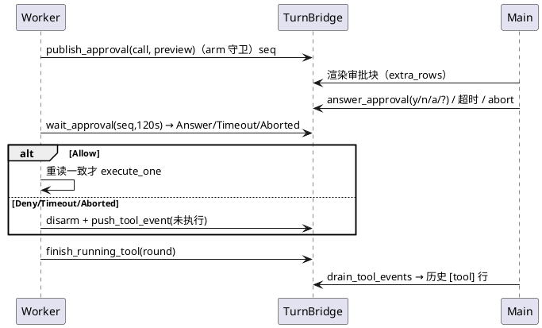
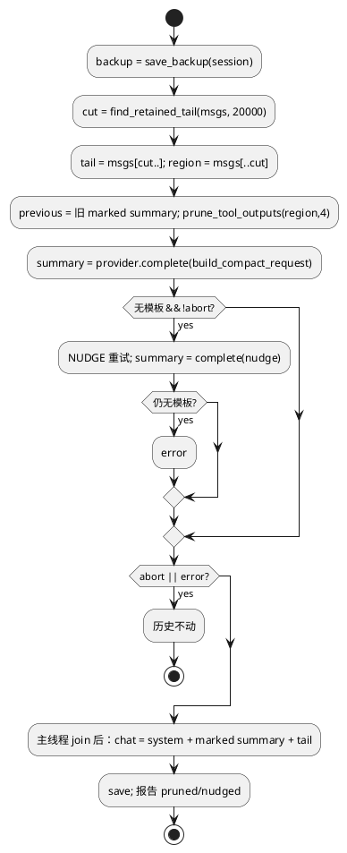
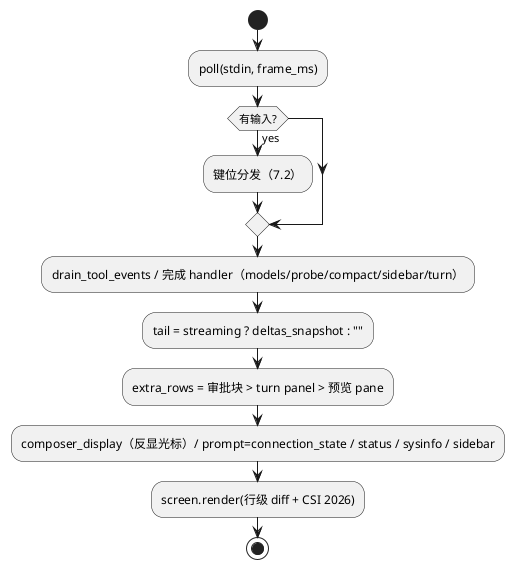

# mini-agent 技术方案 020：状态流转集中描述（state machines）

## 文档状态

- 状态：**草案 / 待人工评审**（2026-11-20）。把散落在 007/008/010/013/017/018、
  architecture.md、ADR 001/006 与 `tui.hpp`/`tui_bridge.hpp`/`loop.cpp` 的状态流转
  集中为单一权威描述；不改变任何行为。图均用 PlantUML。
- 核对基线：main `3e3cbff`。代码缝：`ConnState`/`AuthProbe`/`connection_state`
  （tui.hpp）、`ApprovalWait`/`ApprovalKey`/`TurnBridge`（tui_bridge.hpp）、
  `run_turn`（core/loop.cpp）、各 worker（tui_workers.cpp）。

## 1. 连接/认证状态（ConnState + AuthProbe）

`connection_state(config, probe, listing)` **纯派生、不触网**；提示符 glyph+颜色双编码。
`AuthProbe` 证据来自 `/models` 列表与聊天回合（`source=chat`），凭据一变即重置。



verdict 存于 per-profile `auth_probes` map（v6/v7），`auth` 镜像活动档案；
`auth_log_token` ∈ {untried, verified, rejected, unreachable, refused}。

## 2. 回合生命周期（run_turn + join-then-read）

worker 只写 bridge/result；主线程 join 后才读并提交历史（失败/中断不回滚）。



max-rounds：末轮无工具摘要；提示折进首位 System（008 D7），无首位退化为末尾 User
（提交按下标跳过，永不落盘）。

## 3. 审批流（TurnBridge 固定槽位+序号）



策略 `tool_approval=ask|allowlist|off`；off/allowlist 命中或 session 已允许→直接 Allow。
审批期间键盘被审批独占（y/n/a/?/Esc/Ctrl-C），其余字符吞掉。

## 4. 后台 worker（models/probe/compact/sidebar）

统一 **running/done/stale + join-then-read**：扫描在飞时不 join 主线程（置 stale，
完成后重发）；screen/logger 仅主线程。



## 5. 预览 pane 模态（018）



## 6. session 生命周期（ADR 001）

temp（不落盘）/ normal（原子写+锁）；`/session new|<id>` 进程内切换；
退出时 normal 保存、temp 丢弃；`.lock` 防同 id 并发。

## 7. 详细流程图（activity / sequence，代码核对）

### 7.1 run_turn 工具循环（core/loop.cpp）

```plantuml
@startuml run-turn-activity
start
:staging = copy(chat) + user;
:round = 0; done = false;
repeat
  :last_round = (round == max);
  :tools_for_round = (tools_enabled && !last_round) ? tools_json : "";
  if (tools_enabled && last_round?) then (yes)
    :append_system_note 折进首位 System;
    if (无首位 System?) then (yes)
      :staging.add(末尾 User 提示);
      :limit_note = idx;
    endif
  endif
  :result = ask_provider(staging, tools_for_round);
  :累加 usage / reasoning（prompt 取末轮）;
  if (!tools_enabled || !has_tool_calls || last_round?) then (yes)
    :final_text = result.text;
    :done = true;
  else (no)
    :逐个 tool_call 顺序执行
    (审批 Allow 才 execute; Deny→denied;
    abort→throw Cancelled;
    staging.add(tool message));
  endif
  :++round;
repeat while (round <= max && !done?) is (yes) not (no)
:commit：chat.add(user) + staging[prefix+1..]
跳过 limit_note 与 System（仅成功时）;
:usage_out / reasoning_out 回传; return final_text;
stop
@enduml
```

失败/中断抛 ProviderError → 不 commit，历史停在上一轮边界（007 §5、008 §4）。

### 7.2 中断/Esc 优先级（tui.cpp 输入分支）



Ctrl-C 升级链：preview→关 pane；streaming/compact→首次 abort、已 abort 再按→退出；
idle→2s 内二次→退出，否则清 composer+提示。Ctrl-D 直接退出。审批期间键盘被审批独占。

### 7.3 审批 worker↔主线程时序（tui_bridge.hpp）



### 7.4 /compact 流程（tui_workers.cpp，015/017）



### 7.5 帧渲染管线（tui_frame.hpp，007 §5.6）



## 8. 状态转移表（节选）

| 机器 | 当前态 | 事件 | 下一态 | 副作用 |
| --- | --- | --- | --- | --- |
| conn | Unverified | probe 2xx | Verified | 提示符 `>` 绿 |
| conn | Checking | 401/403 | Rejected | `!` 红 |
| conn | * | 凭据变更 | Unverified | 重置 AuthProbe |
| turn | Streaming | run_turn ok | Commit | 写 chat+save |
| turn | Streaming | abort | Aborted | 不落盘 |
| approval | Waiting | 120s | Timeout→Deny | disarm |
| worker | Running | 再请求 | Stale | 不 join，完成后重发 |
| pane | Open | Esc | Closed | 恢复鼠标 |

## 9. 引用

007 §5.6（帧/中断）、008 §5.4（审批）、010 §13（probe）、013（profile/auth）、
017（compact）、018（pane）、ADR 001（session）、ADR 006（审批策略）。