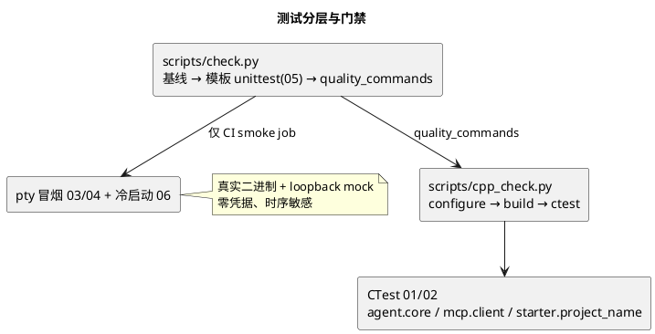

# 测试设计（test design）· 大纲

本目录是 mini-agent 测试体系的**单一权威入口**：本文给出大纲，每块测试的
详细设计见对应编号文档；其他文档（development.md、architecture.md、各设计
文档验证节）只引用这里，不重复展开。

## 大纲

| 编号 | 文档 | 覆盖载体 | 门禁 |
| --- | --- | --- | --- |
| 01 | [单元/契约测试](01-unit-contract.md) | `tests/cpp/agent_test.cpp`、`project_test.cpp`（CTest `agent.core`/`starter.project_name`） | `quality_commands`（cpp_check） |
| 02 | [MCP 客户端测试](02-mcp-client.md) | `tests/cpp/mcp_test.cpp`（CTest `mcp.client`）+ stdio/HTTP mock | `quality_commands` |
| 03 | [TUI pty 端到端冒烟](03-pty-tui-smoke.md) | `tests/pty_tui_smoke.py`（真实二进制 + 进程内 mock SSE） | CI `smoke` |
| 04 | [CLI pty 端到端冒烟](04-pty-cli-smoke.md) | `tests/pty_cli_smoke.py` + `mock_openai_server.py` | CI `smoke` |
| 05 | [模板维护 unittest](05-template-unittest.md) | `tests/test_profiles.py`、`test_template.py` | `check.py` tooling 段 |
| 06 | [冷启动预算](06-cold-start.md) | `tools/cold_start_check.py` | CI `smoke` |
| — | [用例分组清单](case-inventory.md) | 全部载体的用例索引 | — |

## 三层体系（总览）

| 层 | 性质 | 运行入口 |
| --- | --- | --- |
| C++ 单元/契约（01/02） | 纯函数/模块契约，plain `check()` 断言、无框架依赖，经 CTest | `ctest` |
| pty 端到端冒烟（03/04/06） | 驱动真实二进制 over pty/pipe，loopback mock、零凭据、时序敏感 | `python tests/…` / `tools/…` |
| 模板维护 unittest（05） | 模板/初始化/profile 规则，与业务无关 | `unittest discover` |



## 运行与 CI（速览）

```bash
cmake --build --preset linux-gcc-debug && ctest --test-dir build/linux-gcc-debug
python tests/pty_tui_smoke.py ./build/linux-gcc-debug/mini-agent
python tests/pty_cli_smoke.py ./build/linux-gcc-debug/mini-agent
python tools/cold_start_check.py ./build/linux-gcc-debug/mini-agent
python scripts/check.py --require-initialized   # 或 --strict-project / --tooling-only
python scripts/check.py --fast                  # 单 preset build+CTest（refresh OFF），开发快路径
```

**性能与可选**（详见各编号文档）：
- pty 等待已**自适应**（`read_all`/`pump` 见空闲即返回）：TUI ~85s、CLI ~11s。
- 门禁构建默认 **models.dev refresh OFF**（`cpp_check.py`，`--refresh-models` 才开启），
  避免每次构建联网等待；手动 `cmake --preset` 仍默认 ON（010 §21 产品决策不变）。
- `--fast`/单 preset/`ctest -R`/`--tidy`/`--sanitizers`/宽 USER 均为可选；四 preset 矩阵与
  sanitizers 仅 CI。pty 支持 `--grep <标签>` 只让匹配断言门禁（流程仍完整运行）。
  纯重构可只跑 build+ctest，TUI/CLI 改动才跑 pty。

CI（`.github/workflows/project.yml`）：`cpp`=四 preset 矩阵 `--strict-project`；
`smoke`=gcc-debug 构建 + 03/04/06；`quality`=clang-debug clang-tidy + ASan/UBSan。
各命令细节与断言组织见对应编号文档。

## 验证语义

- 基线/模板通过 ≠ 业务通过；profile 起步测试只验证示例行为。
- C++ 主要验证目标是 **Linux GCC/Clang Debug/Release**；交付需说明实际
  compiler/preset 与未验证组合。
- pty 冒烟对墙钟敏感：负载下给足超时；超时截断 ≠ 产品缺陷（019 §5 复核结论）。
- 日志红线：03/04 含"密钥/消息正文零泄露"断言。