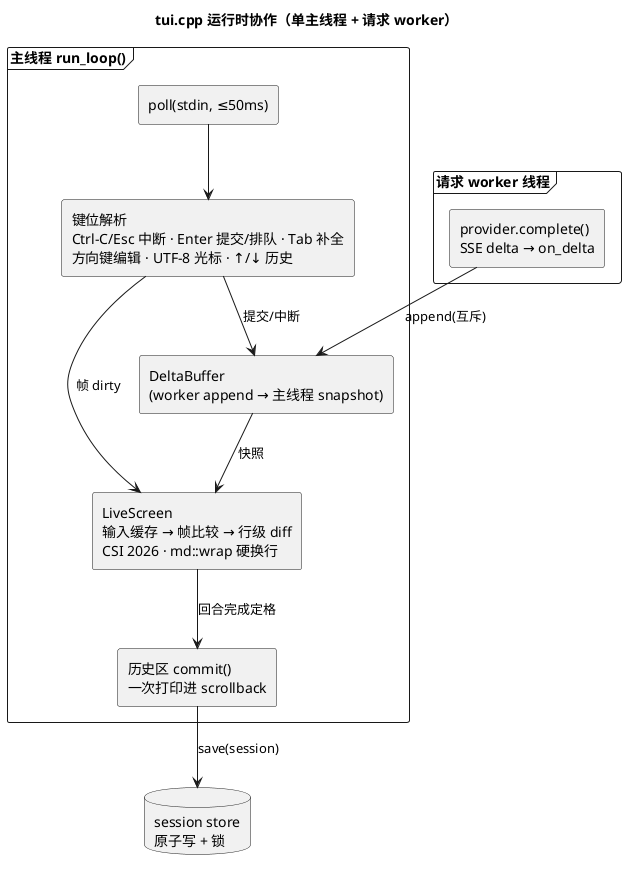

# 业务源码

mini-agent v1 的全部 C++ 实现。构建目标见根目录 `CMakeLists.txt`：`agent_core` 静态库 + `mini-agent` 可执行文件（`cli_main.cpp`）。架构总览与设计约束见 [docs/architecture.md](../docs/architecture.md) 与 [docs/design/007-agent-v1.md](../docs/design/007-agent-v1.md)。

| 文件 | 头文件 | 职责 |
| --- | --- | --- |
| `chat.cpp` | `include/mini_agent/chat.hpp` | `Message`/`Chat` 模型与 JSON 序列化（`schema_version`、Role 含 Tool 预留位） |
| `provider_openai.cpp` | `provider.hpp` | OpenAI 兼容 Chat Completions：libcurl HTTPS + SSE 逐行解析、流式 on_delta、ShouldAbort 中断轮询、`ProviderError` 分类 |
| `loop.cpp` | `loop.hpp` | `run_turn(Chat&, Provider&)` 纯函数式单轮会话（参数注入、无全局单例） |
| `session.cpp` | `session.hpp` | session 存储：加载/校验、`.json.tmp` + rename 原子写（0600）、`<id>.json.lock` 防同 id 并发打开 |
| `config.cpp` | `config.hpp` | 配置合并：env（`MINI_AGENT_*`）优先于 `~/.config/mini-agent/config.json`；原子保存 0600 |
| `md.cpp` | `md.hpp` | ANSI 感知的显示宽度/硬换行 `wrap`/单行 `clip`；Markdown 渲染（`third_party/md4c` 解析 + 自写 SGR writer，ADR 004） |
| `log.cpp` | `log.hpp` | spdlog 包装的诊断日志：key=value 元数据，密钥与消息正文零输出 |
| `tui.cpp` | `tui.hpp` | 自绘 TUI（ADR 003）：termios RAII、poll ≤50ms 帧循环、live 块行级 diff + CSI 2026 同步输出、UTF-8 光标编辑 + ↑/↓ 历史、斜杠命令与 Tab 补全菜单 |
| `cli_main.cpp` | — | 子命令 `ask` / `run` / `session list|rm`，退出码 0/1/2 契约 |
| `project.cpp` | `starter/project.hpp` | 模板骨架遗留（starter_test 使用），非业务代码 |

## TUI 内部结构

不变量（007 §5.6）：所有写入终端的行先经 `md::wrap` 硬换行至 ≤cols，`\x1b[nA` 回退计数因此精确；live 块总行数 ≤ rows−1，块顶不触发终端 auto-scroll。纯逻辑（斜杠注册表、UTF-8 编辑、补全提示）暴露为 `tui.hpp` 可测函数，由 `tests/cpp/agent_test.cpp` 覆盖；真实终端行为由 `tests/pty_tui_smoke.py` 端到端验证。
