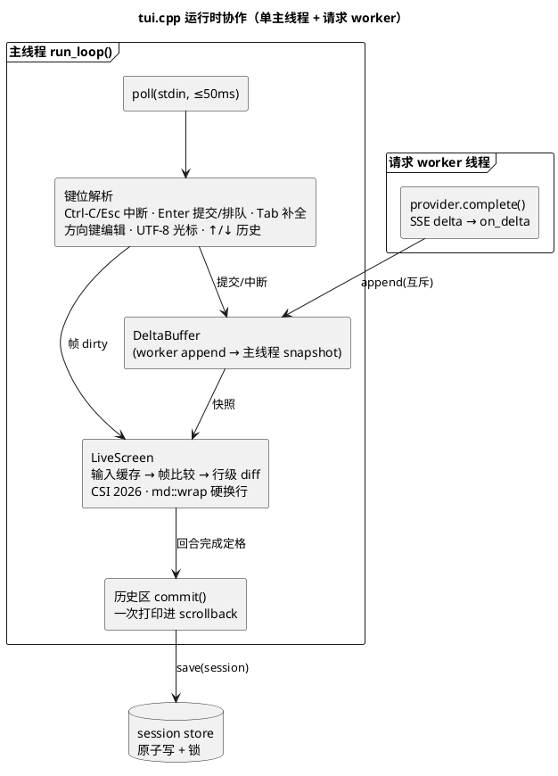

# 业务源码

mini-agent 的 C++ 实现，按模块分层组织（019 拆分）。构建目标见根目录
`CMakeLists.txt`：`agent_core` 静态库 + `mini-agent` 可执行文件
（`src/cli/cli_main.cpp`）。架构总览见 [docs/architecture.md](../docs/architecture.md)，
模块拆分方案见 [docs/design/019-module-split.md](../docs/design/019-module-split.md)。

公共头文件契约保持在 `include/mini_agent/`（不随源码分层移动）；内部头文件
（`cli_common.hpp`、`tui_screen.hpp`、`tui_preview.hpp`、`tui_sidebar.hpp`）与各自
模块同目录。依赖方向：`cli/tui → core/provider/tools/mcp/render → {curl,json,md4c,spdlog}`。

## 目录分层

```
src/
├── cli/        可执行入口：子命令解析 / 退出码 / SIGINT
│   ├── cli_main.cpp        main() 分发 + 构建身份宏
│   ├── cli_common.cpp/.hpp 共享助手 + sigint 通道（namespace cli）
│   └── cli_commands.cpp    cmd_ask / cmd_run / cmd_session / cmd_mcp
├── tui/        自绘 TUI（ADR 003，内联 live 区，无 alternate screen）
│   ├── tui.cpp             run_loop 编排 + 帧渲染 + 状态（TuiState 待建）
│   ├── tui_render.cpp      纯函数渲染/补全助手（单测经 tui.hpp）
│   ├── tui_screen.hpp      RawMode / term size / LiveScreen / tint / 段落切分
│   ├── tui_preview.cpp/.hpp 预览 body 加载 / 行渲染（参数化）
│   └── tui_sidebar.cpp/.hpp 侧栏单级目录 + git changed 扫描（参数化）
├── core/       Agent 内核
│   ├── chat.cpp            Message / Chat 模型 + JSON
│   ├── loop.cpp            run_turn 纯函数式会话循环
│   ├── session.cpp         存储 IO / 原子写 / 文件锁
│   ├── session_serde.cpp   纯 JSON / Markdown 序列化
│   ├── config.cpp          env + 配置文件合并 / 迁移 / 校验
│   ├── context.cpp         017 上下文计量纯函数
│   ├── log.cpp             spdlog 脱敏日志
│   └── project.cpp         模板骨架遗留（starter_test）
├── provider/   OpenAI 兼容 Provider
│   ├── provider_openai.cpp curl HTTPS + SSE + 重试 + 探测
│   ├── provider_parse.cpp  纯 wire 解析/估算（models/probe/overflow/tokens）
│   └── models_dev.cpp      models.dev 窗口目录查表
├── tools/      工具层
│   ├── tools.cpp           ToolRegistry + run_bash + sanitize_display
│   ├── tools_file.cpp      FileRuntime 五工具 + edit/preview 助手
│   ├── tools_git.cpp       GitRuntime 五工具 + porcelain 解析
│   ├── subprocess.cpp      run_subprocess + BoundedOutputSink + cap
│   ├── workspace.cpp       resolve_within_workspace 边界
│   └── diff.cpp            行级 LCS unified diff
├── mcp/        MCP 客户端
│   ├── mcp_rpc.cpp         id 关联 JSON-RPC
│   ├── mcp_stdio.cpp       stdio 子进程传输
│   └── mcp_http.cpp        Streamable HTTP 传输
└── render/     渲染几何 / 高亮
    ├── md.cpp              md4c Markdown → ANSI
    ├── md_geometry.cpp     display_width / wrap / clip
    └── highlight.cpp       语法高亮
```

各模块职责的详细演进（v1–v7、010–019）见对应设计文档；本表只列当前分层。

## TUI 内部结构



不变量（007 §5.6）：所有写入终端的行先经 `md::wrap` 硬换行至 ≤cols，`\x1b[nA`
回退计数因此精确；live 块总行数 ≤ rows−1，块顶不触发终端 auto-scroll。纯逻辑
（斜杠注册表、UTF-8 编辑、补全提示）暴露为 `tui.hpp` 可测函数，由
`tests/cpp/agent_test.cpp` 覆盖；真实终端行为由 `tests/pty_tui_smoke.py` 端到端验证。